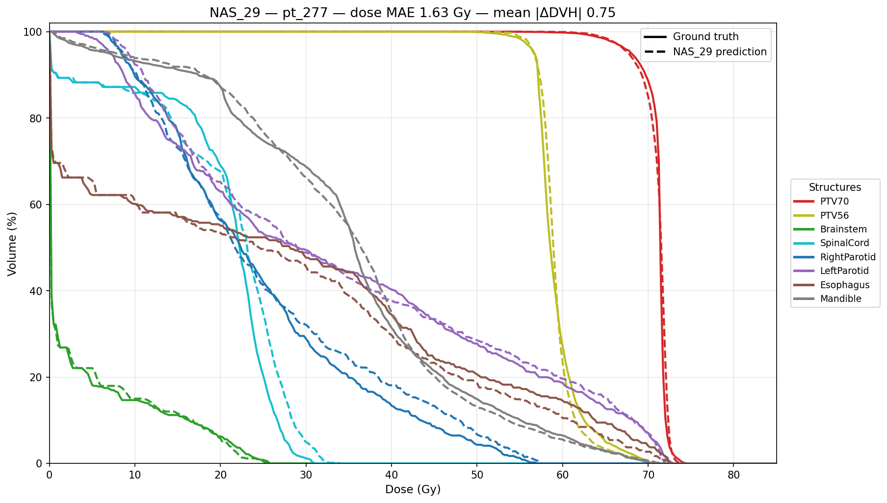
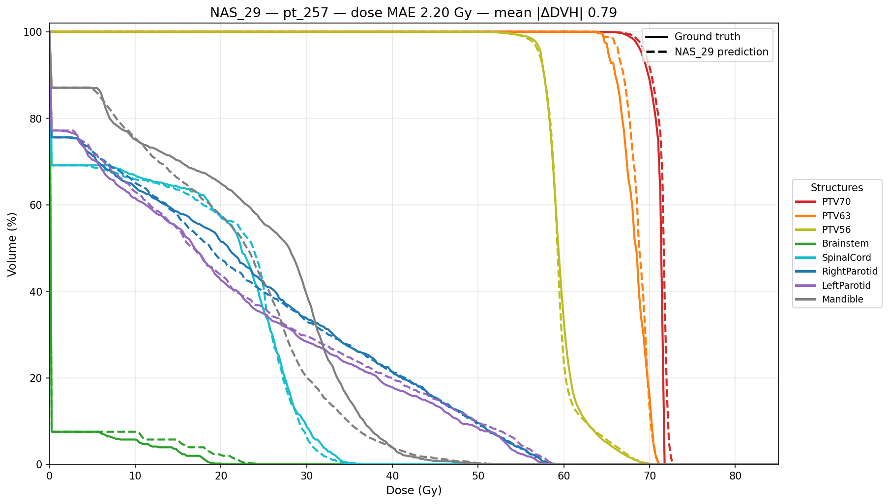
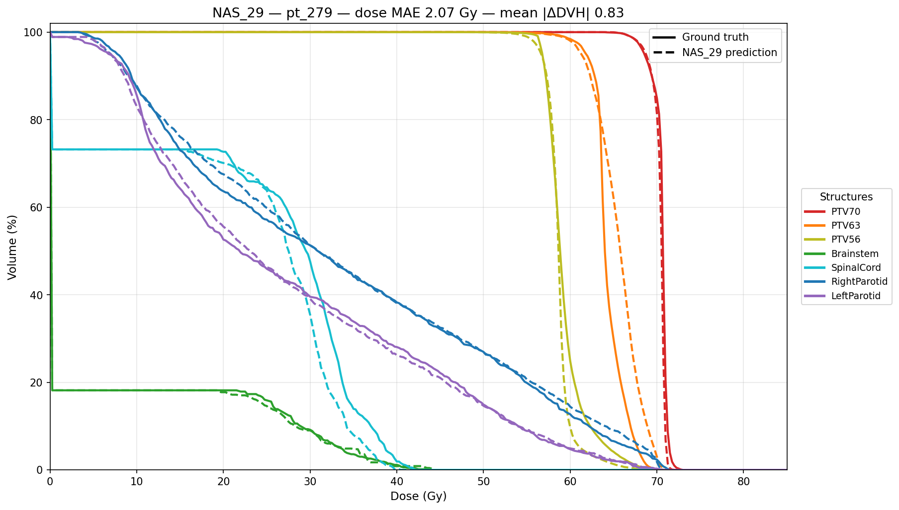
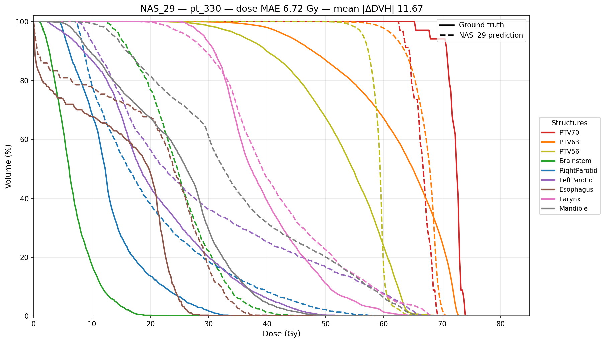
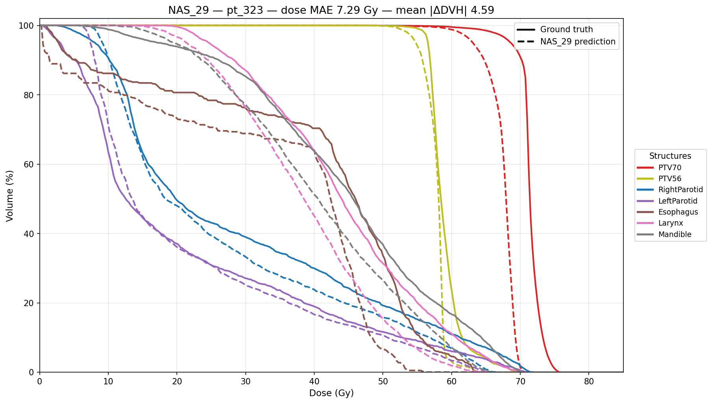
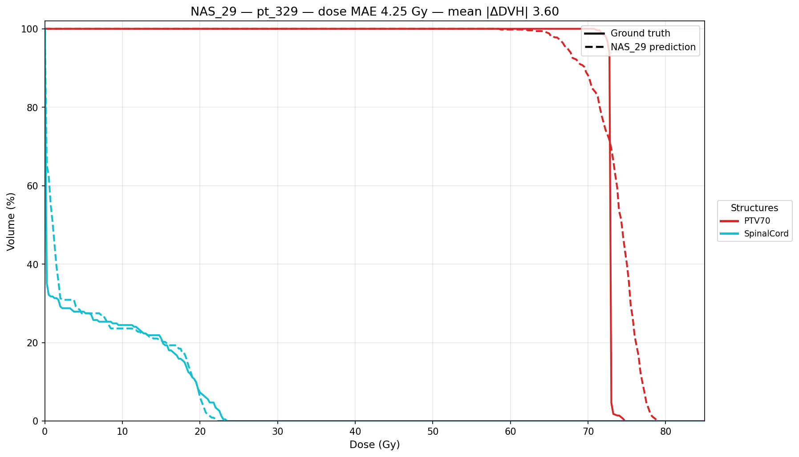

# NAS_29 — test-set results and DVH curves

Model: `NAS_29` (searched U-NAS architecture, 10,945,409 parameters)  
Checkpoint: `best_val_evaluation_index.pkl`  
Test split: OpenKBP patients **241–340** (100 patients)  
Inference: `python test.py --GPU_id 0`, TTA enabled (4 flips averaged)  
Metric definitions: same as `NAS_29/evaluate.py` (D1/D95/D99 for targets, D_0.1cc/mean for OARs; DVH score = mean absolute difference over all structure-metric entries).

## Test-set scores

| Metric | Value |
|---|---:|
| **Dose score (mean MAE)** | **2.555265 ± 1.041586 Gy** |
| **DVH score (mean absolute difference)** | **1.662817 ± 1.991022** |
| Patients | 100 |
| DVH metric entries | 1783 |

## Per-structure test scores

| Structure | Metric | n | GT mean | Pred mean | Mean abs diff |
|---|---|---:|---:|---:|---:|
| PTV70 | D1 | 100 | 74.0109 | 73.0353 | 1.7439 |
| PTV70 | D95 | 100 | 69.0845 | 68.2752 | 1.4091 |
| PTV70 | D99 | 100 | 66.7568 | 65.8424 | 1.8633 |
| PTV63 | D1 | 42 | 72.3295 | 71.4020 | 1.7059 |
| PTV63 | D95 | 42 | 62.9629 | 62.7025 | 1.8346 |
| PTV63 | D99 | 42 | 60.9571 | 60.0859 | 2.5943 |
| PTV56 | D1 | 91 | 68.9951 | 67.8576 | 1.7279 |
| PTV56 | D95 | 91 | 55.8841 | 56.2983 | 1.0439 |
| PTV56 | D99 | 91 | 53.2567 | 53.9206 | 1.4633 |
| Brainstem | D_0.1_cc | 89 | 31.9600 | 32.5065 | 2.4182 |
| Brainstem | mean | 89 | 8.4925 | 8.8421 | 1.0721 |
| SpinalCord | D_0.1_cc | 88 | 34.9463 | 36.0822 | 2.2161 |
| SpinalCord | mean | 88 | 16.9175 | 17.0659 | 0.9738 |
| RightParotid | D_0.1_cc | 99 | 62.9759 | 63.1285 | 1.7283 |
| RightParotid | mean | 99 | 32.0094 | 32.1575 | 1.3891 |
| LeftParotid | D_0.1_cc | 98 | 63.8743 | 64.0051 | 1.6734 |
| LeftParotid | mean | 98 | 31.5491 | 31.5037 | 1.4504 |
| Esophagus | D_0.1_cc | 43 | 54.6892 | 55.3739 | 2.5734 |
| Esophagus | mean | 43 | 27.7506 | 27.2923 | 1.6703 |
| Larynx | D_0.1_cc | 53 | 66.5834 | 66.4325 | 1.7030 |
| Larynx | mean | 53 | 47.9366 | 47.5565 | 1.8231 |
| Mandible | D_0.1_cc | 72 | 69.1744 | 69.0113 | 1.6689 |
| Mandible | mean | 72 | 40.1066 | 39.7538 | 1.7295 |

Ranking for the patient-level DVH curves below: **mean absolute DVH metric difference** across all delineated structures (lower is better).

## Best 3 patients by DVH agreement

| Rank | Patient | Dose MAE (Gy) | Mean abs DVH diff | Structures | Largest metric error |
|---:|---|---:|---:|---:|---|
| 1 | pt_277 | 1.6281 | 0.7499 | 8 | SpinalCord D_0.1_cc (1.768 Gy) |
| 2 | pt_257 | 2.1999 | 0.7896 | 8 | Brainstem D_0.1_cc (4.069 Gy) |
| 3 | pt_279 | 2.0661 | 0.8314 | 7 | SpinalCord D_0.1_cc (2.213 Gy) |

### Best 1: pt_277

Dose MAE **1.6281 Gy**, mean absolute DVH difference **0.7499**.

| Structure | Metric | GT | Prediction | Abs diff |
|---|---|---:|---:|---:|
| SpinalCord | D_0.1_cc | 30.611 | 32.378 | 1.768 |
| Esophagus | mean | 26.969 | 25.481 | 1.488 |
| Mandible | D_0.1_cc | 70.046 | 71.518 | 1.472 |

Solid = ground truth, dashed = NAS_29 prediction. Full figure: `DVH/pt_277_dvh.png`.

### Best 2: pt_257

Dose MAE **2.1999 Gy**, mean absolute DVH difference **0.7896**.

| Structure | Metric | GT | Prediction | Abs diff |
|---|---|---:|---:|---:|
| Brainstem | D_0.1_cc | 18.396 | 22.465 | 4.069 |
| Mandible | mean | 22.734 | 20.332 | 2.402 |
| LeftParotid | D_0.1_cc | 57.400 | 58.742 | 1.341 |

Solid = ground truth, dashed = NAS_29 prediction. Full figure: `DVH/pt_257_dvh.png`.

### Best 3: pt_279

Dose MAE **2.0661 Gy**, mean absolute DVH difference **0.8314**.

| Structure | Metric | GT | Prediction | Abs diff |
|---|---|---:|---:|---:|
| SpinalCord | D_0.1_cc | 41.810 | 39.597 | 2.213 |
| PTV56 | D1 | 67.663 | 65.501 | 2.162 |
| Brainstem | D_0.1_cc | 41.190 | 43.275 | 2.085 |

Solid = ground truth, dashed = NAS_29 prediction. Full figure: `DVH/pt_279_dvh.png`.

## Worst 3 patients by DVH agreement

| Rank | Patient | Dose MAE (Gy) | Mean abs DVH diff | Structures | Largest metric error |
|---:|---|---:|---:|---:|---|
| 1 | pt_330 | 6.7160 | 11.6671 | 9 | PTV56 D99 (25.216 Gy) |
| 2 | pt_323 | 7.2860 | 4.5920 | 7 | Esophagus D_0.1_cc (9.801 Gy) |
| 3 | pt_329 | 4.2535 | 3.5988 | 2 | PTV70 D99 (6.955 Gy) |

### Worst 1: pt_330

Dose MAE **6.7160 Gy**, mean absolute DVH difference **11.6671**.

| Structure | Metric | GT | Prediction | Abs diff |
|---|---|---:|---:|---:|
| PTV56 | D99 | 28.965 | 54.182 | 25.216 |
| RightParotid | D_0.1_cc | 32.479 | 57.197 | 24.718 |
| Brainstem | D_0.1_cc | 17.885 | 41.886 | 24.000 |

Solid = ground truth, dashed = NAS_29 prediction. Full figure: `DVH/pt_330_dvh.png`.

### Worst 2: pt_323

Dose MAE **7.2860 Gy**, mean absolute DVH difference **4.5920**.

| Structure | Metric | GT | Prediction | Abs diff |
|---|---|---:|---:|---:|
| Esophagus | D_0.1_cc | 63.038 | 53.237 | 9.801 |
| Esophagus | mean | 39.593 | 33.561 | 6.032 |
| Larynx | mean | 44.204 | 38.520 | 5.684 |

Solid = ground truth, dashed = NAS_29 prediction. Full figure: `DVH/pt_323_dvh.png`.

### Worst 3: pt_329

Dose MAE **4.2535 Gy**, mean absolute DVH difference **3.5988**.

| Structure | Metric | GT | Prediction | Abs diff |
|---|---|---:|---:|---:|
| PTV70 | D99 | 71.712 | 64.758 | 6.955 |
| PTV70 | D95 | 72.710 | 67.460 | 5.250 |
| PTV70 | D1 | 74.189 | 78.277 | 4.088 |

Solid = ground truth, dashed = NAS_29 prediction. Full figure: `DVH/pt_329_dvh.png`.

<!-- CI_HI_START -->
## Conformity and homogeneity indices (PTV)

Computed on the test patients 241–340, using the ground-truth PTV masks and the predicted / reference dose volumes.

**Definitions**

- **Conformity Index (Paddick):** `CI = TV_PIV² / (TV × PIV)`, where `PIV` is the prescription-isodose volume and `TV_PIV` is the PTV volume receiving at least the prescription dose. Range 0–1, **higher is better**, 1 = ideal.
- **Homogeneity Index (ICRU-83):** `HI = (D2 − D98) / D50` inside the PTV. **Lower is better**, 0 = ideal.
- Prescriptions: PTV70 = 70 Gy, PTV63 = 63 Gy, PTV56 = 56 Gy.
- If no voxel reaches the prescription dose (`PIV = 0`), CI is reported as **0** (failed coverage) rather than undefined.
- PTV63/PTV56 are nested with the higher-dose targets, so their Paddick CI is intrinsically lower: the prescription isodose volume includes the boost region. **PTV70 is the most directly interpretable target-conformity value.**

| PTV | n | CI pred | CI GT | HI pred | HI GT |
|---|---:|---:|---:|---:|---:|
| PTV70 | 100 | 0.7799 ± 0.1473 | 0.7633 ± 0.2000 | 0.0840 ± 0.0279 | 0.0831 ± 0.0439 |
| PTV63 | 42 | 0.2421 ± 0.2201 | 0.2338 ± 0.2027 | 0.1479 ± 0.0253 | 0.1507 ± 0.0659 |
| PTV56 | 91 | 0.3163 ± 0.1882 | 0.3007 ± 0.1912 | 0.1997 ± 0.0423 | 0.2281 ± 0.0631 |
| **Overall** | **233** | **0.5019 ± 0.3011** | **0.4872 ± 0.3110** | **0.1407 ± 0.0624** | **0.1519 ± 0.0864** |

The per-PTV raw values (including coverage, RTOG CI, D2/D98/D50) are in `Evaluation/ci_hi_metrics.csv`.
<!-- CI_HI_END -->

<!-- PER_PATIENT_START -->
## Per-patient test scores (100 patients)

Dose = MAE within `possible_dose_mask` (Gy); DVH = mean absolute difference over all structure-metric entries; CI = Paddick; HI = ICRU-83. PTV70 is present for all 100 patients; PTV63/PTV56 are shown where delineated (`—` otherwise).

| Patient | Dose MAE (Gy) | DVH MAE | CI PTV70 | HI PTV70 | CI PTV63 | HI PTV63 | CI PTV56 | HI PTV56 |
|---:|---:|---:|---:|---:|---:|---:|---:|---:|
| pt_241 | 2.3012 | 1.2220 | 0.8351 | 0.0382 | 0.6580 | 0.1349 | 0.2965 | 0.1038 |
| pt_242 | 1.8695 | 1.6679 | 0.8589 | 0.0435 | — | — | 0.6770 | 0.2236 |
| pt_243 | 3.6719 | 1.4594 | 0.8492 | 0.0886 | 0.0037 | 0.0910 | 0.4682 | 0.2242 |
| pt_244 | 2.0266 | 1.2613 | 0.8934 | 0.0660 | — | — | 0.3959 | 0.2278 |
| pt_245 | 3.0476 | 2.3345 | 0.6349 | 0.0973 | 0.0488 | 0.1347 | 0.1484 | 0.2167 |
| pt_246 | 2.6147 | 1.3475 | 0.9021 | 0.0727 | 0.0575 | 0.1338 | 0.1691 | 0.2239 |
| pt_247 | 1.8809 | 0.8938 | 0.8347 | 0.0906 | — | — | 0.2556 | 0.2212 |
| pt_248 | 1.7550 | 1.1893 | 0.8514 | 0.0619 | — | — | 0.8840 | 0.1566 |
| pt_249 | 3.5871 | 2.3477 | 0.7847 | 0.1119 | — | — | 0.1358 | 0.2025 |
| pt_250 | 1.8452 | 1.0013 | 0.8621 | 0.0620 | — | — | 0.5837 | 0.2383 |
| pt_251 | 3.1187 | 1.2433 | 0.8713 | 0.0473 | 0.2985 | 0.1454 | 0.3030 | 0.1646 |
| pt_252 | 3.2556 | 1.1438 | 0.6118 | 0.1296 | — | — | 0.2329 | 0.1287 |
| pt_253 | 3.2262 | 1.9363 | 0.7893 | 0.0547 | 0.3320 | 0.1570 | 0.3043 | 0.2357 |
| pt_254 | 2.8757 | 1.2796 | 0.8498 | 0.0954 | — | — | 0.2577 | 0.2722 |
| pt_255 | 2.9333 | 0.9998 | 0.7590 | 0.1174 | — | — | 0.3579 | 0.1237 |
| pt_256 | 1.4433 | 1.1600 | 0.8825 | 0.0733 | — | — | 0.5351 | 0.2371 |
| pt_257 | 2.1999 | 0.7896 | 0.9091 | 0.0523 | 0.0294 | 0.0706 | 0.6140 | 0.1933 |
| pt_258 | 1.8900 | 1.6348 | 0.8732 | 0.0765 | — | — | 0.3581 | 0.2391 |
| pt_259 | 2.2300 | 1.5789 | 0.7110 | 0.0400 | 0.6301 | 0.1975 | 0.1784 | 0.1243 |
| pt_260 | 2.5616 | 2.8938 | 0.5803 | 0.1203 | — | — | 0.2052 | 0.2061 |
| pt_261 | 3.3587 | 1.3201 | 0.7264 | 0.0637 | 0.4188 | 0.1708 | 0.0934 | 0.2119 |
| pt_262 | 2.7467 | 1.2303 | 0.8240 | 0.1013 | — | — | 0.2602 | 0.1860 |
| pt_263 | 2.0398 | 1.5234 | 0.8411 | 0.0964 | — | — | 0.5730 | 0.2143 |
| pt_264 | 2.8391 | 1.5678 | 0.8239 | 0.0628 | 0.3591 | 0.1713 | 0.0700 | 0.2291 |
| pt_265 | 1.6755 | 1.5531 | 0.8452 | 0.1051 | — | — | 0.2648 | 0.1987 |
| pt_266 | 2.8031 | 1.0275 | 0.7947 | 0.1107 | — | — | 0.2988 | 0.1704 |
| pt_267 | 2.3592 | 1.1788 | 0.7647 | 0.0750 | — | — | 0.5890 | 0.2378 |
| pt_268 | 3.0290 | 2.2332 | 0.7587 | 0.1025 | 0.0088 | 0.1992 | 0.0616 | 0.2349 |
| pt_269 | 1.8945 | 1.8079 | 0.7195 | 0.1020 | — | — | 0.0023 | 0.1041 |
| pt_270 | 4.0068 | 1.6032 | 0.8486 | 0.0644 | — | — | 0.0755 | 0.2037 |
| pt_271 | 2.4659 | 1.2825 | 0.8495 | 0.0462 | 0.3633 | 0.1381 | 0.3252 | 0.1405 |
| pt_272 | 2.6792 | 2.3147 | 0.7155 | 0.1318 | — | — | 0.0818 | 0.2147 |
| pt_273 | 1.5168 | 0.9917 | 0.8042 | 0.0917 | — | — | — | — |
| pt_274 | 4.2841 | 0.9192 | 0.6225 | 0.1282 | — | — | 0.2842 | 0.1159 |
| pt_275 | 2.6625 | 1.4257 | 0.8892 | 0.0764 | 0.0174 | 0.1238 | 0.3929 | 0.2328 |
| pt_276 | 1.5029 | 1.4385 | 0.8674 | 0.0815 | 0.1043 | 0.1630 | 0.1678 | 0.2180 |
| pt_277 | 1.6281 | 0.7499 | 0.8390 | 0.1009 | — | — | 0.2456 | 0.1912 |
| pt_278 | 3.8396 | 1.5595 | 0.8317 | 0.0867 | 0.1452 | 0.1448 | 0.1634 | 0.2297 |
| pt_279 | 2.0661 | 0.8314 | 0.7986 | 0.0491 | 0.2143 | 0.1542 | 0.4281 | 0.1418 |
| pt_280 | 2.4049 | 1.5593 | 0.8013 | 0.0860 | — | — | 0.6760 | 0.2161 |
| pt_281 | 2.0925 | 1.5019 | 0.8080 | 0.1036 | — | — | 0.3813 | 0.2395 |
| pt_282 | 1.7429 | 2.1831 | 0.7588 | 0.1184 | — | — | — | — |
| pt_283 | 3.7448 | 2.4509 | 0.6167 | 0.0588 | 0.4067 | 0.1709 | 0.1093 | 0.0902 |
| pt_284 | 2.1612 | 1.9928 | 0.6989 | 0.1113 | — | — | 0.1262 | 0.1678 |
| pt_285 | 1.8440 | 1.1917 | 0.8263 | 0.0572 | — | — | 0.7577 | 0.2069 |
| pt_286 | 2.1225 | 1.9037 | 0.8025 | 0.1347 | — | — | 0.1817 | 0.1182 |
| pt_287 | 3.3802 | 1.2299 | 0.9248 | 0.0671 | 0.0030 | 0.1541 | 0.1608 | 0.2369 |
| pt_288 | 1.3972 | 1.1614 | 0.3620 | 0.0613 | 0.5793 | 0.1447 | 0.3331 | 0.1625 |
| pt_289 | 2.9133 | 1.2925 | 0.7597 | 0.0457 | 0.3331 | 0.1636 | 0.2031 | 0.2115 |
| pt_290 | 3.3221 | 2.2813 | 0.6546 | 0.1173 | 0.0051 | 0.1936 | 0.1211 | 0.2390 |
| pt_291 | 1.4784 | 1.2054 | 0.8780 | 0.0928 | — | — | 0.5361 | 0.2284 |
| pt_292 | 2.5336 | 1.7890 | 0.6454 | 0.0875 | — | — | 0.3918 | 0.2166 |
| pt_293 | 1.7439 | 2.9237 | 0.8022 | 0.1131 | — | — | — | — |
| pt_294 | 1.8952 | 1.2463 | 0.8399 | 0.0930 | — | — | 0.4542 | 0.2326 |
| pt_295 | 2.5592 | 1.5000 | 0.8428 | 0.0771 | — | — | 0.3053 | 0.2243 |
| pt_296 | 1.2506 | 1.0206 | 0.8762 | 0.0839 | — | — | 0.3077 | 0.2330 |
| pt_297 | 3.6810 | 2.4412 | 0.8509 | 0.0875 | 0.0338 | 0.1679 | 0.5160 | 0.2232 |
| pt_298 | 2.7357 | 1.2089 | 0.8902 | 0.0674 | — | — | 0.3027 | 0.2574 |
| pt_299 | 1.6607 | 1.3526 | 0.8771 | 0.0903 | — | — | 0.4187 | 0.2219 |
| pt_300 | 3.7653 | 1.4660 | 0.6409 | 0.0443 | 0.4777 | 0.1627 | 0.2620 | 0.1976 |
| pt_301 | 3.1375 | 1.0251 | 0.8522 | 0.0650 | 0.2977 | 0.1625 | 0.1804 | 0.1181 |
| pt_302 | 3.7315 | 2.4769 | 0.8243 | 0.1084 | 0.0276 | 0.1163 | 0.2693 | 0.2198 |
| pt_303 | 2.6990 | 1.5879 | 0.8361 | 0.0501 | 0.1393 | 0.1033 | 0.5775 | 0.2139 |
| pt_304 | 1.7818 | 1.6589 | 0.8260 | 0.1031 | — | — | 0.2215 | 0.1832 |
| pt_305 | 2.9621 | 1.6639 | 0.8637 | 0.0864 | 0.0235 | 0.1231 | 0.1971 | 0.2383 |
| pt_306 | 1.4213 | 1.2144 | 0.8202 | 0.1190 | — | — | 0.2964 | 0.1773 |
| pt_307 | 1.7981 | 1.7253 | 0.8426 | 0.1046 | — | — | 0.2619 | 0.1763 |
| pt_308 | 2.5674 | 1.3372 | 0.8773 | 0.0550 | 0.3425 | 0.1671 | 0.1807 | 0.1818 |
| pt_309 | 1.7338 | 1.5649 | 0.7995 | 0.0696 | 0.0479 | 0.1327 | 0.1009 | 0.1542 |
| pt_310 | 3.4917 | 1.2042 | 0.8827 | 0.0468 | 0.2159 | 0.1441 | 0.0995 | 0.2218 |
| pt_311 | 1.9597 | 1.7234 | 0.8483 | 0.0537 | — | — | 0.6376 | 0.2331 |
| pt_312 | 1.4579 | 1.4398 | 0.8681 | 0.0965 | — | — | 0.1856 | 0.1713 |
| pt_313 | 1.6904 | 1.3616 | 0.7419 | 0.0662 | 0.3352 | 0.1263 | 0.3572 | 0.1985 |
| pt_314 | 2.2435 | 1.7978 | 0.8182 | 0.0757 | — | — | 0.5721 | 0.2437 |
| pt_315 | 1.9456 | 1.6234 | 0.8153 | 0.0579 | — | — | 0.5761 | 0.2475 |
| pt_316 | 2.8920 | 1.7873 | 0.7909 | 0.0988 | — | — | 0.1073 | 0.2792 |
| pt_317 | 3.8726 | 1.8589 | 0.9137 | 0.0809 | 0.0152 | 0.1574 | 0.2645 | 0.2401 |
| pt_318 | 5.0745 | 1.8460 | 0.8027 | 0.0615 | 0.4722 | 0.1699 | 0.2138 | 0.1810 |
| pt_319 | 1.6738 | 2.2296 | 0.6978 | 0.1239 | — | — | — | — |
| pt_320 | 1.4549 | 0.8933 | 0.6918 | 0.1169 | — | — | 0.4115 | 0.2309 |
| pt_321 | 2.8144 | 2.5340 | 0.8305 | 0.0858 | 0.3556 | 0.1484 | 0.1586 | 0.2436 |
| pt_322 | 2.3607 | 2.1818 | 0.8266 | 0.0979 | — | — | — | — |
| pt_323 | 7.2860 | 4.5920 | 0.0145 | 0.1290 | — | — | 0.0823 | 0.1274 |
| pt_324 | 1.9647 | 0.8948 | 0.8142 | 0.0284 | 0.4959 | 0.1527 | 0.2843 | 0.1619 |
| pt_325 | 3.2537 | 1.0377 | 0.5686 | 0.1441 | — | — | 0.2247 | 0.1291 |
| pt_326 | 1.9880 | 1.1516 | 0.8403 | 0.0492 | — | — | 0.6811 | 0.2218 |
| pt_327 | 2.0089 | 1.4243 | 0.7176 | 0.0442 | 0.3615 | 0.1597 | 0.3450 | 0.1787 |
| pt_328 | 1.5574 | 1.0459 | 0.6416 | 0.1253 | — | — | 0.8049 | 0.1859 |
| pt_329 | 4.2535 | 3.5988 | 0.8301 | 0.1677 | — | — | — | — |
| pt_330 | 6.7160 | 11.6671 | 0.0000 | 0.0890 | 0.8816 | 0.1518 | 0.1733 | 0.1252 |
| pt_331 | 2.9606 | 1.1572 | 0.7551 | 0.0408 | 0.4492 | 0.1447 | 0.1474 | 0.2168 |
| pt_332 | 1.5413 | 1.9563 | 0.4359 | 0.1279 | — | — | — | — |
| pt_333 | 1.4770 | 0.8895 | 0.8752 | 0.0852 | — | — | 0.4366 | 0.2194 |
| pt_334 | 1.3375 | 0.8938 | 0.8940 | 0.0542 | — | — | 0.5554 | 0.2457 |
| pt_335 | 4.2538 | 1.9004 | 0.8194 | 0.0687 | 0.0305 | 0.1244 | 0.2801 | 0.2014 |
| pt_336 | 2.8227 | 1.3097 | 0.8947 | 0.0785 | 0.0257 | 0.1375 | 0.2004 | 0.2519 |
| pt_337 | 1.5701 | 1.0047 | 0.7840 | 0.0659 | — | — | — | — |
| pt_338 | 1.4605 | 1.0328 | 0.8226 | 0.1003 | — | — | — | — |
| pt_339 | 1.5172 | 2.2530 | 0.8559 | 0.0833 | 0.0966 | 0.1595 | 0.1750 | 0.1788 |
| pt_340 | 2.6320 | 0.8996 | 0.8957 | 0.0780 | 0.0259 | 0.1445 | 0.2398 | 0.2128 |
| **Mean** | 2.5553 | 1.6629 | 0.7799 | 0.0840 | 0.2421 | 0.1479 | 0.3163 | 0.1997 |

Mean CI/HI for PTV63/PTV56 are over the patients where the structure is delineated. Because PTV63/PTV56 are nested with higher-dose targets, their Paddick CI is intrinsically lower; PTV70 is the primary conformity value.
The Mean row is the unweighted average over the 100 patients; the official DVH score in the test-set table above averages over all 1,783 structure-metric entries, so it can differ slightly from the mean of the per-patient DVH column.
<!-- PER_PATIENT_END -->

## All outputs

- `Evaluation/EVALUATION.md` — full evaluation report
- `Evaluation/per_patient_metrics.csv` — 100 rows
- `Evaluation/per_structure_metrics.csv` — 1783 metric rows
- `Evaluation/ci_hi_metrics.csv` — PTV conformity/homogeneity raw values
- `DVH/pt_241_dvh.png` … `DVH/pt_340_dvh.png` — one DVH figure per test patient
- `DVH/all_patients_dvh.pdf` — 101-page PDF (100 patients + mean summary)
- `DVH/mean_dvh_per_structure.png` — mean GT/prediction DVH per structure
- `DVH/dvh_curves.npz` — raw curves on a 0.25 Gy grid
