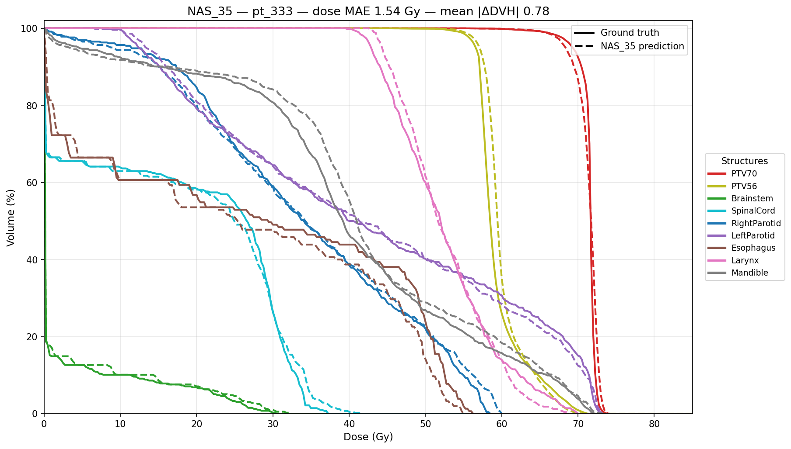
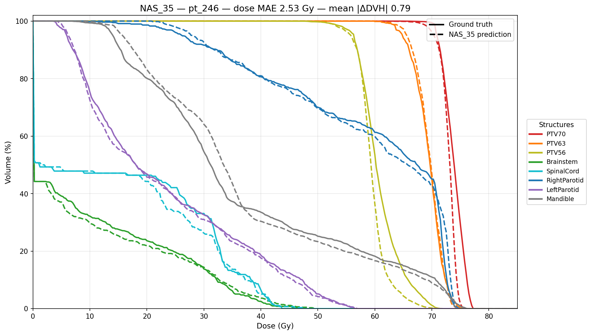
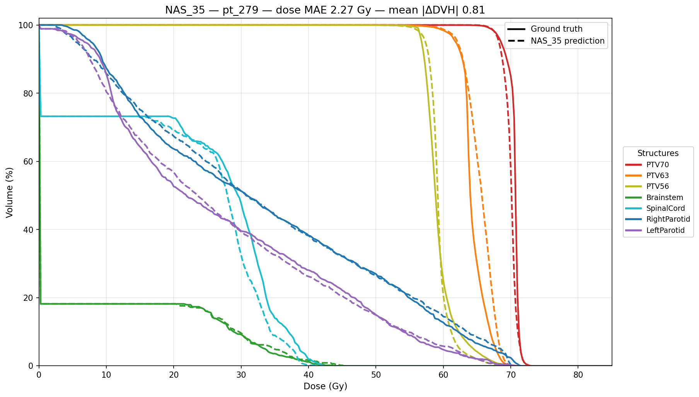
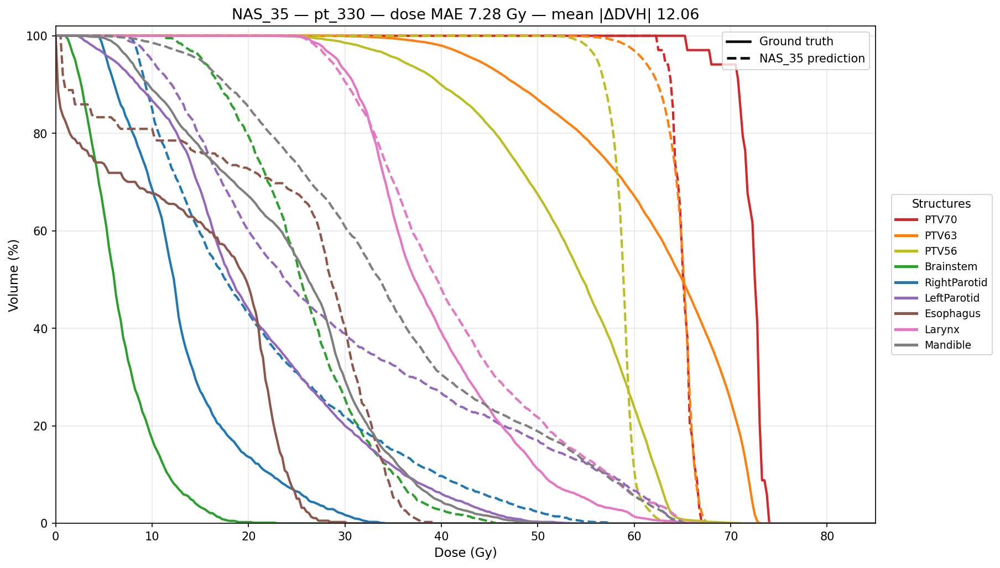
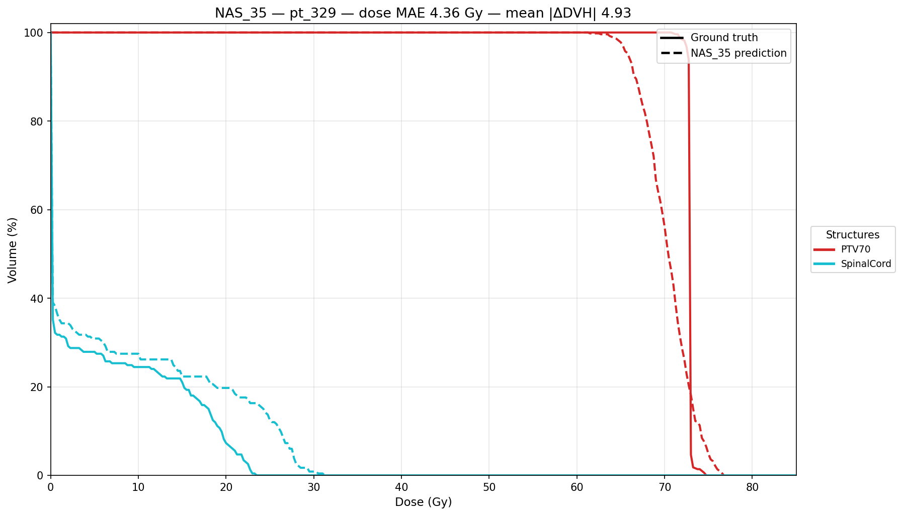
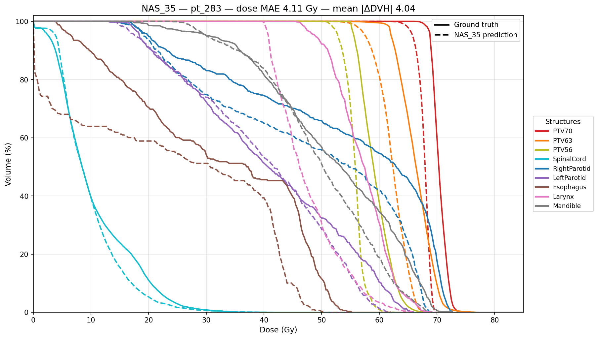

# NAS_35 — test-set results and DVH curves

Model: `NAS_35` (searched U-NAS architecture, 8,392,937 parameters)  
Checkpoint: `best_val_evaluation_index.pkl`  
Test split: OpenKBP patients **241–340** (100 patients)  
Inference: `python test.py --GPU_id 0 --TTA True`, TTA enabled (4 flips averaged)  
Metric definitions: same as `evaluate.py` (D1/D95/D99 for targets, D_0.1cc/mean for OARs; DVH score = mean absolute difference over all structure-metric entries).

## Training configuration

| Item | Value |
|---|---|
| Batch size | 2 |
| Iterations | 80,000 |
| Iterations / epoch | 500 (batch_size × 500 samples) |
| Epochs | 160 |
| Optimizer | Adam |
| Learning rate | 3e-4, cosine decay to 1e-7 |
| Weight decay | 3e-5 effective |
| Loss | masked L1 on dose / 70 |
| Validation | dose MAE on patients 201–240 |

## Test-set scores

| Metric | Value |
|---|---:|
| **Dose score (mean MAE)** | **2.641266 ± 1.042151 Gy** |
| **DVH score (mean absolute difference)** | **1.798900 ± 2.019790** |
| Patients | 100 |
| DVH metric entries | 1783 |

## Per-structure test scores

| Structure | Metric | n | GT mean | Pred mean | Mean abs diff |
|---|---|---:|---:|---:|---:|
| PTV70 | D1 | 100 | 74.0109 | 73.4291 | 1.8588 |
| PTV70 | D95 | 100 | 69.0845 | 67.9912 | 1.7013 |
| PTV70 | D99 | 100 | 66.7568 | 65.9213 | 1.9577 |
| PTV63 | D1 | 42 | 72.3295 | 71.0233 | 1.9732 |
| PTV63 | D95 | 42 | 62.9629 | 63.1238 | 1.9959 |
| PTV63 | D99 | 42 | 60.9571 | 60.7162 | 2.5595 |
| PTV56 | D1 | 91 | 68.9951 | 67.4321 | 1.9680 |
| PTV56 | D95 | 91 | 55.8841 | 56.4651 | 1.2340 |
| PTV56 | D99 | 91 | 53.2567 | 53.9809 | 1.5609 |
| Brainstem | D_0.1_cc | 89 | 31.9600 | 32.5104 | 2.6273 |
| Brainstem | mean | 89 | 8.4925 | 8.7755 | 1.1198 |
| SpinalCord | D_0.1_cc | 88 | 34.9463 | 35.9909 | 2.2486 |
| SpinalCord | mean | 88 | 16.9175 | 16.7418 | 0.8718 |
| RightParotid | D_0.1_cc | 99 | 62.9759 | 62.7951 | 1.9096 |
| RightParotid | mean | 99 | 32.0094 | 31.9182 | 1.5700 |
| LeftParotid | D_0.1_cc | 98 | 63.8743 | 63.4871 | 1.8841 |
| LeftParotid | mean | 98 | 31.5491 | 31.4043 | 1.4788 |
| Esophagus | D_0.1_cc | 43 | 54.6892 | 55.5387 | 2.7599 |
| Esophagus | mean | 43 | 27.7506 | 27.4145 | 2.0273 |
| Larynx | D_0.1_cc | 53 | 66.5834 | 66.5269 | 1.8782 |
| Larynx | mean | 53 | 47.9366 | 47.7829 | 1.9130 |
| Mandible | D_0.1_cc | 72 | 69.1744 | 68.8910 | 1.8263 |
| Mandible | mean | 72 | 40.1066 | 39.9178 | 1.7728 |

Ranking for the patient-level DVH curves below: **mean absolute DVH metric difference** across all delineated structures (lower is better).

## Best 3 patients by DVH agreement

| Rank | Patient | Dose MAE (Gy) | Mean abs DVH diff | Structures | Largest metric error |
|---:|---|---:|---:|---:|---|
| 1 | pt_333 | 1.5428 | 0.7831 | 9 | SpinalCord D_0.1_cc (2.591 Gy) |
| 2 | pt_246 | 2.5315 | 0.7871 | 8 | PTV56 D1 (2.055 Gy) |
| 3 | pt_279 | 2.2676 | 0.8057 | 7 | Brainstem D_0.1_cc (2.806 Gy) |

### Best 1: pt_333

Dose MAE **1.5428 Gy**, mean absolute DVH difference **0.7831**.

| Structure | Metric | GT | Prediction | Abs diff |
|---|---|---:|---:|---:|
| SpinalCord | D_0.1_cc | 37.190 | 39.781 | 2.591 |
| RightParotid | D_0.1_cc | 57.984 | 59.834 | 1.850 |
| Larynx | D_0.1_cc | 69.702 | 68.099 | 1.604 |

Solid = ground truth, dashed = NAS_35 prediction. Full figure: `DVH/pt_333_dvh.png`.

### Best 2: pt_246

Dose MAE **2.5315 Gy**, mean absolute DVH difference **0.7871**.

| Structure | Metric | GT | Prediction | Abs diff |
|---|---|---:|---:|---:|
| PTV56 | D1 | 70.136 | 68.080 | 2.055 |
| PTV70 | D99 | 70.407 | 68.360 | 2.047 |
| PTV70 | D1 | 77.022 | 75.168 | 1.855 |

Solid = ground truth, dashed = NAS_35 prediction. Full figure: `DVH/pt_246_dvh.png`.

### Best 3: pt_279

Dose MAE **2.2676 Gy**, mean absolute DVH difference **0.8057**.

| Structure | Metric | GT | Prediction | Abs diff |
|---|---|---:|---:|---:|
| Brainstem | D_0.1_cc | 41.190 | 43.996 | 2.806 |
| SpinalCord | D_0.1_cc | 41.810 | 39.300 | 2.510 |
| LeftParotid | D_0.1_cc | 69.620 | 68.175 | 1.445 |

Solid = ground truth, dashed = NAS_35 prediction. Full figure: `DVH/pt_279_dvh.png`.

## Worst 3 patients by DVH agreement

| Rank | Patient | Dose MAE (Gy) | Mean abs DVH diff | Structures | Largest metric error |
|---:|---|---:|---:|---:|---|
| 1 | pt_330 | 7.2809 | 12.0556 | 9 | Brainstem D_0.1_cc (26.815 Gy) |
| 2 | pt_329 | 4.3565 | 4.9349 | 2 | PTV70 D99 (7.537 Gy) |
| 3 | pt_283 | 4.1093 | 4.0386 | 9 | Larynx mean (9.488 Gy) |

### Worst 1: pt_330

Dose MAE **7.2809 Gy**, mean absolute DVH difference **12.0556**.

| Structure | Metric | GT | Prediction | Abs diff |
|---|---|---:|---:|---:|
| Brainstem | D_0.1_cc | 17.885 | 44.700 | 26.815 |
| PTV56 | D99 | 28.965 | 54.200 | 25.235 |
| RightParotid | D_0.1_cc | 32.479 | 55.390 | 22.911 |

Solid = ground truth, dashed = NAS_35 prediction. Full figure: `DVH/pt_330_dvh.png`.

### Worst 2: pt_329

Dose MAE **4.3565 Gy**, mean absolute DVH difference **4.9349**.

| Structure | Metric | GT | Prediction | Abs diff |
|---|---|---:|---:|---:|
| PTV70 | D99 | 71.712 | 64.175 | 7.537 |
| PTV70 | D95 | 72.710 | 65.866 | 6.843 |
| SpinalCord | D_0.1_cc | 22.767 | 29.394 | 6.627 |

Solid = ground truth, dashed = NAS_35 prediction. Full figure: `DVH/pt_329_dvh.png`.

### Worst 3: pt_283

Dose MAE **4.1093 Gy**, mean absolute DVH difference **4.0386**.

| Structure | Metric | GT | Prediction | Abs diff |
|---|---|---:|---:|---:|
| Larynx | mean | 57.073 | 47.585 | 9.488 |
| Esophagus | mean | 32.504 | 24.440 | 8.064 |
| RightParotid | mean | 54.139 | 48.292 | 5.847 |

Solid = ground truth, dashed = NAS_35 prediction. Full figure: `DVH/pt_283_dvh.png`.

<!-- CI_HI_START -->
## Conformity and homogeneity indices (PTV)

Computed on the test patients 241–340, using the ground-truth PTV masks and the predicted / reference dose volumes.

**Definitions**

- **Conformity Index (Paddick):** `CI = TV_PIV² / (TV × PIV)`, where `PIV` is the prescription-isodose volume and `TV_PIV` is the PTV volume receiving at least the prescription dose. Range 0–1, **higher is better**, 1 = ideal.
- **Homogeneity Index (ICRU-83):** `HI = (D2 − D98) / D50` inside the PTV. **Lower is better**, 0 = ideal.
- Prescriptions: PTV70 = 70 Gy, PTV63 = 63 Gy, PTV56 = 56 Gy.
- If no voxel reaches the prescription dose (`PIV = 0`), CI is reported as **0** (failed coverage) rather than undefined.
- PTV63/PTV56 are nested with the higher-dose targets, so their Paddick CI is intrinsically lower: the prescription isodose volume includes the boost region. **PTV70 is the most directly interpretable target-conformity value.**

| PTV | n | CI pred | CI GT | HI pred | HI GT |
|---|---:|---:|---:|---:|---:|
| PTV70 | 100 | 0.6952 ± 0.2106 | 0.7633 ± 0.2000 | 0.0893 ± 0.0215 | 0.0831 ± 0.0439 |
| PTV63 | 42 | 0.2395 ± 0.2184 | 0.2338 ± 0.2027 | 0.1327 ± 0.0211 | 0.1507 ± 0.0659 |
| PTV56 | 91 | 0.3060 ± 0.1801 | 0.3007 ± 0.1912 | 0.1921 ± 0.0364 | 0.2281 ± 0.0631 |
| **Overall** | **233** | **0.4611 ± 0.2865** | **0.4872 ± 0.3110** | **0.1373 ± 0.0544** | **0.1519 ± 0.0864** |

The per-PTV raw values (including coverage, RTOG CI, D2/D98/D50) are in `Evaluation/ci_hi_metrics.csv`.
<!-- CI_HI_END -->

<!-- PER_PATIENT_START -->
## Per-patient test scores (100 patients)

Dose = MAE within `possible_dose_mask` (Gy); DVH = mean absolute difference over all structure-metric entries; CI = Paddick; HI = ICRU-83. PTV70 is present for all 100 patients; PTV63/PTV56 are shown where delineated (`—` otherwise).

| Patient | Dose MAE (Gy) | DVH MAE | CI PTV70 | HI PTV70 | CI PTV63 | HI PTV63 | CI PTV56 | HI PTV56 |
|---:|---:|---:|---:|---:|---:|---:|---:|---:|
| pt_241 | 2.5340 | 1.3281 | 0.8390 | 0.0469 | 0.6693 | 0.1172 | 0.2894 | 0.1177 |
| pt_242 | 2.1002 | 1.9672 | 0.7792 | 0.0817 | — | — | 0.6534 | 0.1931 |
| pt_243 | 3.7478 | 1.4044 | 0.8258 | 0.0935 | 0.0034 | 0.0997 | 0.4514 | 0.2059 |
| pt_244 | 1.9827 | 1.1579 | 0.8718 | 0.0811 | — | — | 0.3938 | 0.2013 |
| pt_245 | 3.0620 | 2.6925 | 0.0899 | 0.0803 | 0.0510 | 0.1054 | 0.1430 | 0.2028 |
| pt_246 | 2.5315 | 0.7871 | 0.8927 | 0.0778 | 0.0558 | 0.1275 | 0.1702 | 0.2283 |
| pt_247 | 2.1537 | 1.2425 | 0.8541 | 0.1003 | — | — | 0.2483 | 0.2114 |
| pt_248 | 2.4158 | 2.0050 | 0.7876 | 0.0828 | — | — | 0.8217 | 0.1621 |
| pt_249 | 3.4612 | 2.2276 | 0.6581 | 0.0966 | — | — | 0.1205 | 0.1861 |
| pt_250 | 1.9198 | 1.1280 | 0.8751 | 0.0721 | — | — | 0.5651 | 0.2215 |
| pt_251 | 2.9843 | 1.4658 | 0.8538 | 0.0599 | 0.3212 | 0.1295 | 0.3027 | 0.1682 |
| pt_252 | 3.2547 | 1.5361 | 0.4370 | 0.1271 | — | — | 0.2140 | 0.1490 |
| pt_253 | 3.0169 | 1.9711 | 0.7110 | 0.0665 | 0.3372 | 0.1192 | 0.3241 | 0.2073 |
| pt_254 | 2.9176 | 1.0668 | 0.8275 | 0.0870 | — | — | 0.2686 | 0.2345 |
| pt_255 | 2.7202 | 1.3749 | 0.8073 | 0.1158 | — | — | 0.3537 | 0.1136 |
| pt_256 | 1.7834 | 1.4792 | 0.9034 | 0.0835 | — | — | 0.4942 | 0.2170 |
| pt_257 | 2.3678 | 0.8919 | 0.9209 | 0.0702 | 0.0276 | 0.0722 | 0.5961 | 0.1933 |
| pt_258 | 1.9610 | 1.1475 | 0.6639 | 0.0911 | — | — | 0.3431 | 0.2228 |
| pt_259 | 2.2865 | 1.5758 | 0.6991 | 0.0547 | 0.6203 | 0.1737 | 0.1702 | 0.1262 |
| pt_260 | 3.1175 | 3.6541 | 0.2758 | 0.1309 | — | — | 0.1196 | 0.2433 |
| pt_261 | 3.1433 | 1.2564 | 0.6280 | 0.0763 | 0.4171 | 0.1476 | 0.0934 | 0.1831 |
| pt_262 | 2.9078 | 1.3484 | 0.4217 | 0.1033 | — | — | 0.2367 | 0.1909 |
| pt_263 | 2.1405 | 1.4752 | 0.8424 | 0.0984 | — | — | 0.5579 | 0.1979 |
| pt_264 | 2.3010 | 1.1354 | 0.8563 | 0.0670 | 0.3776 | 0.1439 | 0.0731 | 0.2391 |
| pt_265 | 1.8392 | 1.5997 | 0.7779 | 0.1096 | — | — | 0.2601 | 0.1875 |
| pt_266 | 3.2056 | 1.4375 | 0.6864 | 0.1152 | — | — | 0.2921 | 0.1559 |
| pt_267 | 2.3845 | 1.8112 | 0.6291 | 0.0833 | — | — | 0.5866 | 0.2093 |
| pt_268 | 3.0029 | 2.1839 | 0.8009 | 0.1027 | 0.0112 | 0.1780 | 0.0623 | 0.2391 |
| pt_269 | 1.8355 | 1.9268 | 0.5626 | 0.0898 | — | — | 0.0023 | 0.1001 |
| pt_270 | 5.1059 | 2.2850 | 0.2503 | 0.0810 | — | — | 0.0755 | 0.1855 |
| pt_271 | 2.8405 | 1.2911 | 0.8587 | 0.0603 | 0.3501 | 0.1418 | 0.3171 | 0.1582 |
| pt_272 | 2.7676 | 1.7210 | 0.4976 | 0.1210 | — | — | 0.0758 | 0.2384 |
| pt_273 | 1.5210 | 0.9165 | 0.8141 | 0.1010 | — | — | — | — |
| pt_274 | 3.6492 | 1.6611 | 0.7704 | 0.1173 | — | — | 0.3021 | 0.1273 |
| pt_275 | 3.0568 | 1.3136 | 0.6212 | 0.0901 | 0.0191 | 0.1059 | 0.3870 | 0.2071 |
| pt_276 | 1.5193 | 1.6777 | 0.8372 | 0.0912 | 0.1466 | 0.1328 | 0.1679 | 0.2039 |
| pt_277 | 1.6103 | 0.8698 | 0.8079 | 0.1039 | — | — | 0.2398 | 0.1790 |
| pt_278 | 3.1316 | 1.1264 | 0.8554 | 0.0976 | 0.1444 | 0.1286 | 0.1727 | 0.2151 |
| pt_279 | 2.2676 | 0.8057 | 0.5744 | 0.0595 | 0.2308 | 0.1233 | 0.4240 | 0.1432 |
| pt_280 | 3.0072 | 1.7319 | 0.8522 | 0.0795 | — | — | 0.5775 | 0.1988 |
| pt_281 | 2.1985 | 1.5162 | 0.7629 | 0.1053 | — | — | 0.3753 | 0.2096 |
| pt_282 | 1.7634 | 1.9500 | 0.4040 | 0.1101 | — | — | — | — |
| pt_283 | 4.1093 | 4.0386 | 0.0000 | 0.0650 | 0.1731 | 0.1661 | 0.0294 | 0.1306 |
| pt_284 | 2.7067 | 2.4419 | 0.7806 | 0.1091 | — | — | 0.1261 | 0.1812 |
| pt_285 | 2.0345 | 1.1296 | 0.8951 | 0.0698 | — | — | 0.7194 | 0.2038 |
| pt_286 | 2.3298 | 2.6960 | 0.6870 | 0.1342 | — | — | 0.1736 | 0.1369 |
| pt_287 | 3.2455 | 1.3406 | 0.8986 | 0.0781 | 0.0030 | 0.1387 | 0.1610 | 0.2154 |
| pt_288 | 1.4207 | 1.3202 | 0.4635 | 0.1015 | 0.5986 | 0.1472 | 0.3233 | 0.1323 |
| pt_289 | 2.9451 | 1.3690 | 0.8713 | 0.0574 | 0.3456 | 0.1476 | 0.2072 | 0.1853 |
| pt_290 | 3.5532 | 3.0169 | 0.2668 | 0.1019 | 0.0049 | 0.1571 | 0.1023 | 0.2466 |
| pt_291 | 1.6641 | 1.3974 | 0.8211 | 0.1059 | — | — | 0.5289 | 0.2023 |
| pt_292 | 2.3847 | 1.8691 | 0.4787 | 0.0776 | — | — | 0.3907 | 0.2099 |
| pt_293 | 2.0432 | 3.3627 | 0.5056 | 0.1055 | — | — | — | — |
| pt_294 | 2.0205 | 1.3828 | 0.7922 | 0.1050 | — | — | 0.4466 | 0.2143 |
| pt_295 | 2.6690 | 1.5034 | 0.8315 | 0.0940 | — | — | 0.3109 | 0.2240 |
| pt_296 | 1.2716 | 1.1887 | 0.7428 | 0.0877 | — | — | 0.3088 | 0.2063 |
| pt_297 | 3.2177 | 1.6126 | 0.8514 | 0.0867 | 0.0296 | 0.1203 | 0.4991 | 0.1949 |
| pt_298 | 2.6824 | 1.2628 | 0.8779 | 0.0824 | — | — | 0.2987 | 0.2391 |
| pt_299 | 1.6428 | 1.5067 | 0.8248 | 0.0964 | — | — | 0.4109 | 0.1953 |
| pt_300 | 3.9339 | 1.1173 | 0.7096 | 0.0504 | 0.4753 | 0.1366 | 0.2606 | 0.1906 |
| pt_301 | 3.2140 | 1.1771 | 0.8594 | 0.0781 | 0.3066 | 0.1464 | 0.1926 | 0.1227 |
| pt_302 | 4.0609 | 2.3709 | 0.7408 | 0.1041 | 0.0272 | 0.1091 | 0.2689 | 0.2050 |
| pt_303 | 2.8080 | 1.2953 | 0.8745 | 0.0585 | 0.1393 | 0.1147 | 0.5658 | 0.2031 |
| pt_304 | 1.9054 | 1.7725 | 0.7898 | 0.1056 | — | — | 0.2207 | 0.1759 |
| pt_305 | 2.8913 | 1.2401 | 0.8705 | 0.0995 | 0.0228 | 0.1120 | 0.1978 | 0.2349 |
| pt_306 | 1.4445 | 1.0088 | 0.8026 | 0.1239 | — | — | 0.2946 | 0.1814 |
| pt_307 | 1.8554 | 2.2729 | 0.6750 | 0.1093 | — | — | 0.2487 | 0.1935 |
| pt_308 | 2.8559 | 1.6374 | 0.8112 | 0.0651 | 0.3240 | 0.1433 | 0.1795 | 0.1778 |
| pt_309 | 1.8472 | 1.8332 | 0.7260 | 0.0607 | 0.0470 | 0.1183 | 0.0980 | 0.1395 |
| pt_310 | 3.9783 | 2.0260 | 0.4928 | 0.0652 | 0.2010 | 0.1279 | 0.0958 | 0.2282 |
| pt_311 | 1.9493 | 1.5873 | 0.8611 | 0.0632 | — | — | 0.5998 | 0.2081 |
| pt_312 | 1.6019 | 1.0015 | 0.7066 | 0.1075 | — | — | 0.1792 | 0.1607 |
| pt_313 | 1.6135 | 1.2023 | 0.8593 | 0.0608 | 0.4166 | 0.1130 | 0.3522 | 0.1922 |
| pt_314 | 2.3149 | 2.0888 | 0.5402 | 0.0841 | — | — | 0.5625 | 0.2147 |
| pt_315 | 2.0152 | 1.7187 | 0.7858 | 0.0742 | — | — | 0.5732 | 0.2286 |
| pt_316 | 3.0301 | 1.8713 | 0.7159 | 0.1033 | — | — | 0.1017 | 0.2975 |
| pt_317 | 4.1042 | 1.7802 | 0.8940 | 0.0888 | 0.0163 | 0.1486 | 0.2659 | 0.2201 |
| pt_318 | 5.0021 | 2.0081 | 0.7083 | 0.0780 | 0.4601 | 0.1800 | 0.2132 | 0.1836 |
| pt_319 | 1.7724 | 1.8153 | 0.6048 | 0.1147 | — | — | — | — |
| pt_320 | 1.6817 | 1.2454 | 0.7002 | 0.1242 | — | — | 0.4099 | 0.2256 |
| pt_321 | 2.9027 | 3.1898 | 0.5757 | 0.0943 | 0.3550 | 0.1352 | 0.1584 | 0.2407 |
| pt_322 | 2.2903 | 2.7271 | 0.8440 | 0.0934 | — | — | — | — |
| pt_323 | 7.1225 | 3.4592 | 0.0478 | 0.1053 | — | — | 0.0781 | 0.1516 |
| pt_324 | 2.0246 | 1.0980 | 0.8790 | 0.0451 | 0.4910 | 0.1430 | 0.2829 | 0.1514 |
| pt_325 | 3.0506 | 1.2408 | 0.3144 | 0.1273 | — | — | 0.2068 | 0.1479 |
| pt_326 | 1.8280 | 1.3789 | 0.8924 | 0.0728 | — | — | 0.6307 | 0.2018 |
| pt_327 | 2.0030 | 1.2342 | 0.8185 | 0.0561 | 0.3562 | 0.1419 | 0.3366 | 0.1759 |
| pt_328 | 1.8226 | 1.5930 | 0.6229 | 0.1210 | — | — | 0.7534 | 0.1659 |
| pt_329 | 4.3565 | 4.9349 | 0.5534 | 0.1534 | — | — | — | — |
| pt_330 | 7.2809 | 12.0556 | 0.0000 | 0.0575 | 0.8562 | 0.1187 | 0.1709 | 0.1154 |
| pt_331 | 2.8525 | 1.6481 | 0.7830 | 0.0655 | 0.4470 | 0.1386 | 0.1482 | 0.2219 |
| pt_332 | 1.6053 | 2.2875 | 0.2507 | 0.1065 | — | — | — | — |
| pt_333 | 1.5428 | 0.7831 | 0.8477 | 0.0889 | — | — | 0.4260 | 0.1994 |
| pt_334 | 1.3561 | 1.0958 | 0.8767 | 0.0675 | — | — | 0.5462 | 0.2266 |
| pt_335 | 3.9633 | 1.9504 | 0.7483 | 0.0744 | 0.0305 | 0.1199 | 0.2794 | 0.1991 |
| pt_336 | 2.9108 | 2.1862 | 0.6774 | 0.0907 | 0.0265 | 0.1329 | 0.1911 | 0.2214 |
| pt_337 | 1.7430 | 1.2117 | 0.6336 | 0.0924 | — | — | — | — |
| pt_338 | 1.5361 | 1.3352 | 0.6627 | 0.0990 | — | — | — | — |
| pt_339 | 1.8080 | 2.8289 | 0.6206 | 0.0971 | 0.0961 | 0.1267 | 0.1717 | 0.1627 |
| pt_340 | 2.7877 | 0.9193 | 0.8701 | 0.0855 | 0.0263 | 0.1437 | 0.2296 | 0.2247 |
| **Mean** | 2.6413 | 1.8081 | 0.6952 | 0.0893 | 0.2395 | 0.1327 | 0.3060 | 0.1921 |

Mean CI/HI for PTV63/PTV56 are over the patients where the structure is delineated. Because PTV63/PTV56 are nested with higher-dose targets, their Paddick CI is intrinsically lower; PTV70 is the primary conformity value.
The Mean row is the unweighted average over the 100 patients; the official DVH score in the test-set table above averages over all 1,783 structure-metric entries, so it can differ slightly from the mean of the per-patient DVH column.
<!-- PER_PATIENT_END -->

## All outputs

- `Evaluation/EVALUATION.md` — full evaluation report
- `Evaluation/per_patient_metrics.csv` — 100 rows
- `Evaluation/per_structure_metrics.csv` — 1783 metric rows
- `Evaluation/ci_hi_metrics.csv` — PTV conformity/homogeneity raw values
- `DVH/pt_241_dvh.png` … `DVH/pt_340_dvh.png` — one DVH figure per test patient
- `DVH/all_patients_dvh.pdf` — multi-page PDF with the mean summary
- `DVH/mean_dvh_per_structure.png` — mean GT/prediction DVH per structure
- `DVH/dvh_curves.npz` — raw curves on a 0.25 Gy grid
