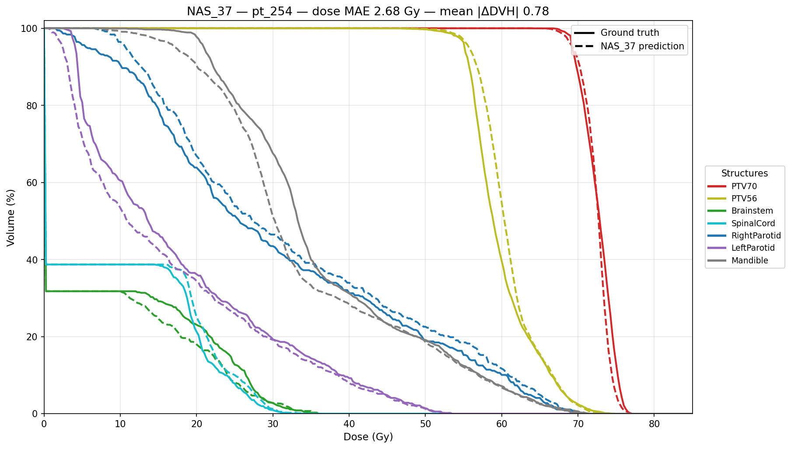
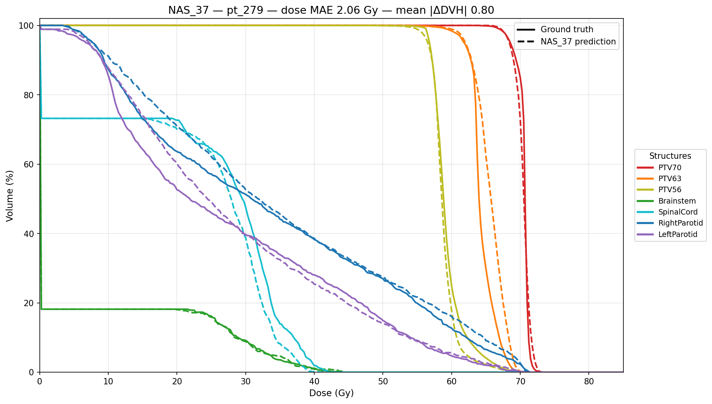
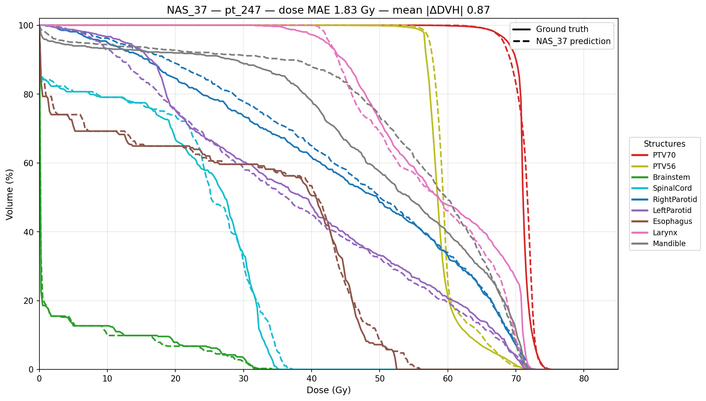
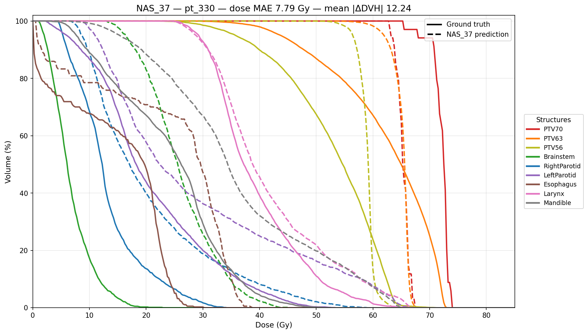
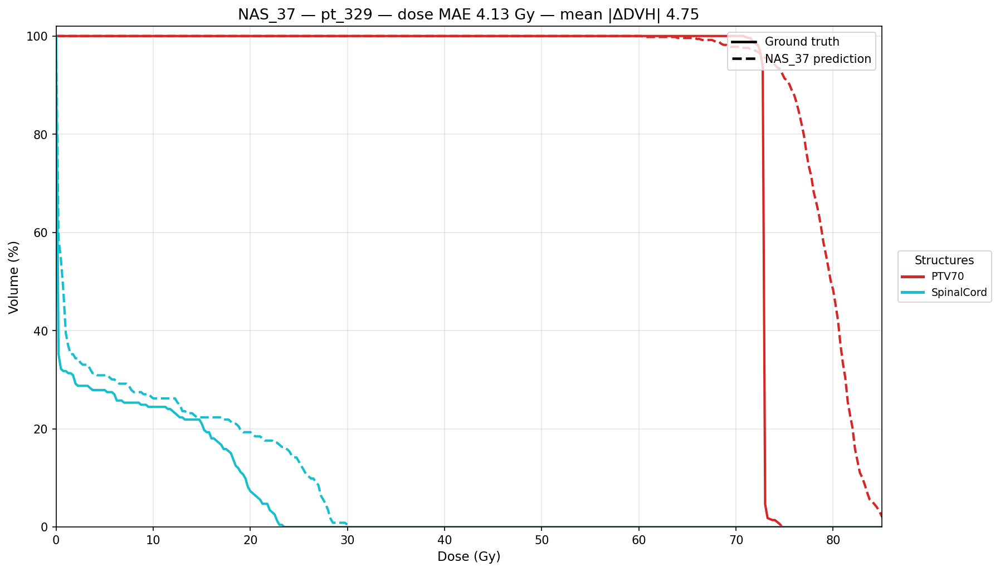
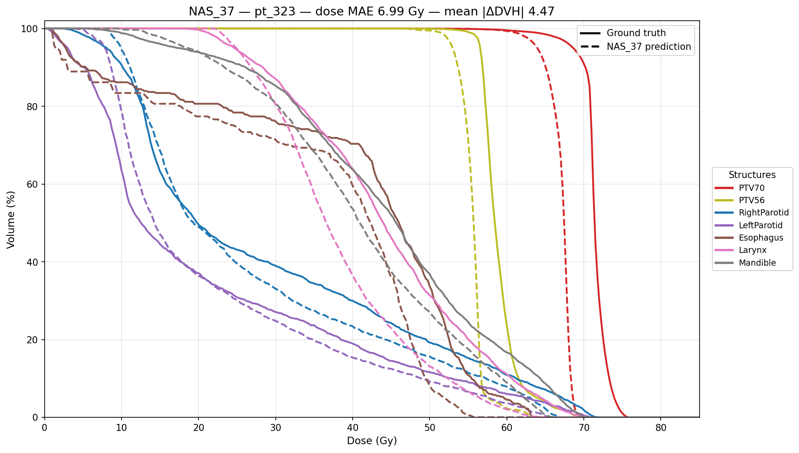

# NAS_37 — test-set results and DVH curves

Model: `NAS_37` (searched U-NAS architecture, 13,195,493 parameters)  
Checkpoint: `best_val_evaluation_index.pkl`  
Test split: OpenKBP patients **241–340** (100 patients)  
Inference: `python test.py --GPU_id 0 --TTA True`, TTA enabled (4 flips averaged)  
Metric definitions: same as `evaluate.py` (D1/D95/D99 for targets, D_0.1cc/mean for OARs; DVH score = mean absolute difference over all structure-metric entries).

## Training configuration

| Item | Value |
|---|---|
| Batch size | 2 |
| Iterations | 80,000 |
| Iterations / epoch | 500 (batch_size × 500 samples) |
| Epochs | 160 |
| Optimizer | Adam |
| Learning rate | 3e-4, cosine decay to 1e-7 |
| Weight decay | 3e-5 effective |
| Loss | masked L1 on dose / 70 |
| Validation | dose MAE on patients 201–240 |

## Test-set scores

| Metric | Value |
|---|---:|
| **Dose score (mean MAE)** | **2.597840 ± 1.071105 Gy** |
| **DVH score (mean absolute difference)** | **1.693051 ± 2.030131** |
| Patients | 100 |
| DVH metric entries | 1783 |

## Per-structure test scores

| Structure | Metric | n | GT mean | Pred mean | Mean abs diff |
|---|---|---:|---:|---:|---:|
| PTV70 | D1 | 100 | 74.0109 | 73.8108 | 1.8203 |
| PTV70 | D95 | 100 | 69.0845 | 68.3842 | 1.4760 |
| PTV70 | D99 | 100 | 66.7568 | 66.2581 | 1.8892 |
| PTV63 | D1 | 42 | 72.3295 | 71.4711 | 1.6431 |
| PTV63 | D95 | 42 | 62.9629 | 63.5320 | 1.7899 |
| PTV63 | D99 | 42 | 60.9571 | 61.3185 | 2.2372 |
| PTV56 | D1 | 91 | 68.9951 | 67.9545 | 1.6627 |
| PTV56 | D95 | 91 | 55.8841 | 56.4865 | 1.2358 |
| PTV56 | D99 | 91 | 53.2567 | 54.1158 | 1.5550 |
| Brainstem | D_0.1_cc | 89 | 31.9600 | 32.4738 | 2.6314 |
| Brainstem | mean | 89 | 8.4925 | 8.7949 | 1.1482 |
| SpinalCord | D_0.1_cc | 88 | 34.9463 | 36.0402 | 2.1048 |
| SpinalCord | mean | 88 | 16.9175 | 16.7616 | 0.8901 |
| RightParotid | D_0.1_cc | 99 | 62.9759 | 63.2804 | 1.7384 |
| RightParotid | mean | 99 | 32.0094 | 32.1040 | 1.3385 |
| LeftParotid | D_0.1_cc | 98 | 63.8743 | 64.2570 | 1.6047 |
| LeftParotid | mean | 98 | 31.5491 | 31.4722 | 1.4597 |
| Esophagus | D_0.1_cc | 43 | 54.6892 | 55.7622 | 2.7831 |
| Esophagus | mean | 43 | 27.7506 | 27.7060 | 1.7869 |
| Larynx | D_0.1_cc | 53 | 66.5834 | 66.0497 | 1.9371 |
| Larynx | mean | 53 | 47.9366 | 47.4040 | 1.9435 |
| Mandible | D_0.1_cc | 72 | 69.1744 | 69.1459 | 1.6232 |
| Mandible | mean | 72 | 40.1066 | 40.2024 | 1.8448 |

Ranking for the patient-level DVH curves below: **mean absolute DVH metric difference** across all delineated structures (lower is better).

## Best 3 patients by DVH agreement

| Rank | Patient | Dose MAE (Gy) | Mean abs DVH diff | Structures | Largest metric error |
|---:|---|---:|---:|---:|---|
| 1 | pt_254 | 2.6798 | 0.7755 | 7 | Mandible mean (1.999 Gy) |
| 2 | pt_279 | 2.0557 | 0.7991 | 7 | SpinalCord D_0.1_cc (2.625 Gy) |
| 3 | pt_247 | 1.8295 | 0.8730 | 9 | Mandible mean (3.988 Gy) |

### Best 1: pt_254

Dose MAE **2.6798 Gy**, mean absolute DVH difference **0.7755**.

| Structure | Metric | GT | Prediction | Abs diff |
|---|---|---:|---:|---:|
| Mandible | mean | 36.682 | 34.683 | 1.999 |
| RightParotid | mean | 30.824 | 32.797 | 1.974 |
| LeftParotid | mean | 17.638 | 16.232 | 1.406 |

Solid = ground truth, dashed = NAS_37 prediction. Full figure: `DVH/pt_254_dvh.png`.

### Best 2: pt_279

Dose MAE **2.0557 Gy**, mean absolute DVH difference **0.7991**.

| Structure | Metric | GT | Prediction | Abs diff |
|---|---|---:|---:|---:|
| SpinalCord | D_0.1_cc | 41.810 | 39.185 | 2.625 |
| Brainstem | D_0.1_cc | 41.190 | 43.293 | 2.103 |
| RightParotid | mean | 33.279 | 35.002 | 1.723 |

Solid = ground truth, dashed = NAS_37 prediction. Full figure: `DVH/pt_279_dvh.png`.

### Best 3: pt_247

Dose MAE **1.8295 Gy**, mean absolute DVH difference **0.8730**.

| Structure | Metric | GT | Prediction | Abs diff |
|---|---|---:|---:|---:|
| Mandible | mean | 50.762 | 54.750 | 3.988 |
| Esophagus | D_0.1_cc | 52.458 | 54.806 | 2.348 |
| SpinalCord | D_0.1_cc | 34.815 | 36.353 | 1.539 |

Solid = ground truth, dashed = NAS_37 prediction. Full figure: `DVH/pt_247_dvh.png`.

## Worst 3 patients by DVH agreement

| Rank | Patient | Dose MAE (Gy) | Mean abs DVH diff | Structures | Largest metric error |
|---:|---|---:|---:|---:|---|
| 1 | pt_330 | 7.7902 | 12.2375 | 9 | PTV56 D99 (25.107 Gy) |
| 2 | pt_329 | 4.1319 | 4.7453 | 2 | PTV70 D1 (11.602 Gy) |
| 3 | pt_323 | 6.9938 | 4.4653 | 7 | Esophagus D_0.1_cc (8.548 Gy) |

### Worst 1: pt_330

Dose MAE **7.7902 Gy**, mean absolute DVH difference **12.2375**.

| Structure | Metric | GT | Prediction | Abs diff |
|---|---|---:|---:|---:|
| PTV56 | D99 | 28.965 | 54.072 | 25.107 |
| Brainstem | D_0.1_cc | 17.885 | 42.789 | 24.904 |
| RightParotid | D_0.1_cc | 32.479 | 56.565 | 24.086 |

Solid = ground truth, dashed = NAS_37 prediction. Full figure: `DVH/pt_330_dvh.png`.

### Worst 2: pt_329

Dose MAE **4.1319 Gy**, mean absolute DVH difference **4.7453**.

| Structure | Metric | GT | Prediction | Abs diff |
|---|---|---:|---:|---:|
| PTV70 | D1 | 74.189 | 85.791 | 11.602 |
| SpinalCord | D_0.1_cc | 22.767 | 28.489 | 5.722 |
| PTV70 | D99 | 71.712 | 67.979 | 3.734 |

Solid = ground truth, dashed = NAS_37 prediction. Full figure: `DVH/pt_329_dvh.png`.

### Worst 3: pt_323

Dose MAE **6.9938 Gy**, mean absolute DVH difference **4.4653**.

| Structure | Metric | GT | Prediction | Abs diff |
|---|---|---:|---:|---:|
| Esophagus | D_0.1_cc | 63.038 | 54.491 | 8.548 |
| Larynx | D_0.1_cc | 70.202 | 64.115 | 6.087 |
| Larynx | mean | 44.204 | 38.219 | 5.985 |

Solid = ground truth, dashed = NAS_37 prediction. Full figure: `DVH/pt_323_dvh.png`.

<!-- CI_HI_START -->
## Conformity and homogeneity indices (PTV)

Computed on the test patients 241–340, using the ground-truth PTV masks and the predicted / reference dose volumes.

**Definitions**

- **Conformity Index (Paddick):** `CI = TV_PIV² / (TV × PIV)`, where `PIV` is the prescription-isodose volume and `TV_PIV` is the PTV volume receiving at least the prescription dose. Range 0–1, **higher is better**, 1 = ideal.
- **Homogeneity Index (ICRU-83):** `HI = (D2 − D98) / D50` inside the PTV. **Lower is better**, 0 = ideal.
- Prescriptions: PTV70 = 70 Gy, PTV63 = 63 Gy, PTV56 = 56 Gy.
- If no voxel reaches the prescription dose (`PIV = 0`), CI is reported as **0** (failed coverage) rather than undefined.
- PTV63/PTV56 are nested with the higher-dose targets, so their Paddick CI is intrinsically lower: the prescription isodose volume includes the boost region. **PTV70 is the most directly interpretable target-conformity value.**

| PTV | n | CI pred | CI GT | HI pred | HI GT |
|---|---:|---:|---:|---:|---:|
| PTV70 | 100 | 0.7245 ± 0.2261 | 0.7633 ± 0.2000 | 0.0892 ± 0.0245 | 0.0831 ± 0.0439 |
| PTV63 | 42 | 0.2457 ± 0.2213 | 0.2338 ± 0.2027 | 0.1319 ± 0.0242 | 0.1507 ± 0.0659 |
| PTV56 | 91 | 0.3108 ± 0.1865 | 0.3007 ± 0.1912 | 0.1985 ± 0.0419 | 0.2281 ± 0.0631 |
| **Overall** | **233** | **0.4767 ± 0.3018** | **0.4872 ± 0.3110** | **0.1396 ± 0.0592** | **0.1519 ± 0.0864** |

The per-PTV raw values (including coverage, RTOG CI, D2/D98/D50) are in `Evaluation/ci_hi_metrics.csv`.
<!-- CI_HI_END -->

<!-- PER_PATIENT_START -->
## Per-patient test scores (100 patients)

Dose = MAE within `possible_dose_mask` (Gy); DVH = mean absolute difference over all structure-metric entries; CI = Paddick; HI = ICRU-83. PTV70 is present for all 100 patients; PTV63/PTV56 are shown where delineated (`—` otherwise).

| Patient | Dose MAE (Gy) | DVH MAE | CI PTV70 | HI PTV70 | CI PTV63 | HI PTV63 | CI PTV56 | HI PTV56 |
|---:|---:|---:|---:|---:|---:|---:|---:|---:|
| pt_241 | 2.3745 | 1.4615 | 0.8167 | 0.0474 | 0.6801 | 0.1156 | 0.2919 | 0.1106 |
| pt_242 | 2.0407 | 1.7964 | 0.8478 | 0.0687 | — | — | 0.6809 | 0.2184 |
| pt_243 | 3.7070 | 1.3263 | 0.8349 | 0.0899 | 0.0035 | 0.0814 | 0.4519 | 0.2155 |
| pt_244 | 2.0391 | 1.2068 | 0.7594 | 0.0701 | — | — | 0.3952 | 0.2115 |
| pt_245 | 3.4057 | 2.7615 | 0.1331 | 0.0836 | 0.0480 | 0.1207 | 0.1377 | 0.2356 |
| pt_246 | 2.6104 | 0.9100 | 0.9143 | 0.0785 | 0.0567 | 0.1232 | 0.1763 | 0.2083 |
| pt_247 | 1.8295 | 0.8730 | 0.8127 | 0.0934 | — | — | 0.2529 | 0.2050 |
| pt_248 | 1.9871 | 1.5900 | 0.8571 | 0.0876 | — | — | 0.8695 | 0.1616 |
| pt_249 | 3.3953 | 2.7009 | 0.7595 | 0.1033 | — | — | 0.1359 | 0.1768 |
| pt_250 | 1.8411 | 0.9810 | 0.8208 | 0.0783 | — | — | 0.5932 | 0.2399 |
| pt_251 | 3.1378 | 1.0254 | 0.8916 | 0.0521 | 0.3420 | 0.1226 | 0.3032 | 0.1605 |
| pt_252 | 3.1727 | 1.1357 | 0.6831 | 0.1154 | — | — | 0.2374 | 0.1472 |
| pt_253 | 3.2101 | 1.5373 | 0.7949 | 0.0623 | 0.3327 | 0.1394 | 0.3188 | 0.2123 |
| pt_254 | 2.6798 | 0.7755 | 0.8673 | 0.1005 | — | — | 0.2608 | 0.2591 |
| pt_255 | 2.7356 | 1.3792 | 0.8070 | 0.1079 | — | — | 0.3586 | 0.1156 |
| pt_256 | 1.3487 | 1.0876 | 0.8720 | 0.0823 | — | — | 0.5261 | 0.2419 |
| pt_257 | 2.4757 | 1.1279 | 0.9449 | 0.0580 | 0.0282 | 0.0582 | 0.5957 | 0.1881 |
| pt_258 | 1.8545 | 1.4540 | 0.8283 | 0.0817 | — | — | 0.3564 | 0.2337 |
| pt_259 | 2.2190 | 1.0675 | 0.7355 | 0.0591 | 0.6129 | 0.1725 | 0.1748 | 0.1145 |
| pt_260 | 2.5195 | 3.0492 | 0.1146 | 0.0904 | — | — | 0.1726 | 0.2173 |
| pt_261 | 3.4903 | 1.4939 | 0.7713 | 0.0853 | 0.4311 | 0.1438 | 0.0898 | 0.2006 |
| pt_262 | 2.8427 | 1.3937 | 0.6941 | 0.0972 | — | — | 0.2538 | 0.1824 |
| pt_263 | 2.2057 | 1.7378 | 0.8034 | 0.0992 | — | — | 0.5703 | 0.2079 |
| pt_264 | 2.4058 | 0.9017 | 0.8394 | 0.0646 | 0.3800 | 0.1424 | 0.0742 | 0.2409 |
| pt_265 | 1.7073 | 1.5901 | 0.7729 | 0.1050 | — | — | 0.2635 | 0.1845 |
| pt_266 | 2.9267 | 1.0089 | 0.7816 | 0.1114 | — | — | 0.2968 | 0.1647 |
| pt_267 | 2.4529 | 1.4603 | 0.7537 | 0.0957 | — | — | 0.5770 | 0.2382 |
| pt_268 | 2.8957 | 1.9225 | 0.8368 | 0.1009 | 0.0099 | 0.1734 | 0.0620 | 0.2359 |
| pt_269 | 1.9266 | 2.2355 | 0.6949 | 0.0917 | — | — | 0.0022 | 0.0777 |
| pt_270 | 4.4593 | 1.5742 | 0.7382 | 0.0704 | — | — | 0.0752 | 0.2029 |
| pt_271 | 2.3729 | 0.9076 | 0.8524 | 0.0552 | 0.3657 | 0.1345 | 0.3214 | 0.1493 |
| pt_272 | 2.8537 | 2.3173 | 0.6319 | 0.1147 | — | — | 0.0767 | 0.2327 |
| pt_273 | 1.6967 | 1.2483 | 0.8084 | 0.1049 | — | — | — | — |
| pt_274 | 3.8675 | 1.2651 | 0.3153 | 0.1145 | — | — | 0.2688 | 0.1343 |
| pt_275 | 3.2544 | 1.1357 | 0.9058 | 0.0818 | 0.0175 | 0.0867 | 0.3790 | 0.2185 |
| pt_276 | 1.4485 | 1.6509 | 0.8499 | 0.0840 | 0.1492 | 0.1304 | 0.1649 | 0.2183 |
| pt_277 | 1.4721 | 0.9505 | 0.8533 | 0.1077 | — | — | 0.2402 | 0.1795 |
| pt_278 | 3.5688 | 0.9403 | 0.8255 | 0.0978 | 0.1434 | 0.1377 | 0.1642 | 0.2316 |
| pt_279 | 2.0557 | 0.7991 | 0.7269 | 0.0660 | 0.2324 | 0.1248 | 0.4217 | 0.1638 |
| pt_280 | 2.4777 | 1.6058 | 0.8044 | 0.0777 | — | — | 0.6524 | 0.2159 |
| pt_281 | 2.1273 | 1.6700 | 0.7783 | 0.1086 | — | — | 0.3674 | 0.2156 |
| pt_282 | 1.7055 | 1.8220 | 0.3533 | 0.1009 | — | — | — | — |
| pt_283 | 3.7137 | 3.0606 | 0.0150 | 0.0853 | 0.2912 | 0.1237 | 0.0674 | 0.0902 |
| pt_284 | 2.5197 | 2.9808 | 0.8351 | 0.1054 | — | — | 0.1322 | 0.1761 |
| pt_285 | 2.0753 | 1.2532 | 0.8485 | 0.0637 | — | — | 0.7633 | 0.2175 |
| pt_286 | 2.0877 | 2.3161 | 0.7741 | 0.1481 | — | — | 0.1795 | 0.1378 |
| pt_287 | 3.4159 | 1.3140 | 0.8976 | 0.0873 | 0.0032 | 0.1418 | 0.1657 | 0.2256 |
| pt_288 | 1.4756 | 1.6921 | 0.4575 | 0.1041 | 0.5667 | 0.1492 | 0.3211 | 0.1295 |
| pt_289 | 2.9409 | 1.2040 | 0.8188 | 0.0557 | 0.3364 | 0.1454 | 0.2031 | 0.2062 |
| pt_290 | 3.6157 | 2.6362 | 0.2488 | 0.1030 | 0.0052 | 0.1467 | 0.1100 | 0.2391 |
| pt_291 | 1.5479 | 1.4008 | 0.8339 | 0.1151 | — | — | 0.5341 | 0.2174 |
| pt_292 | 2.6759 | 1.8629 | 0.4518 | 0.0757 | — | — | 0.3827 | 0.2228 |
| pt_293 | 1.6850 | 2.7240 | 0.7433 | 0.1129 | — | — | — | — |
| pt_294 | 2.0048 | 1.3635 | 0.7236 | 0.1038 | — | — | 0.4476 | 0.2363 |
| pt_295 | 2.6274 | 1.1684 | 0.8716 | 0.0856 | — | — | 0.3087 | 0.2337 |
| pt_296 | 1.3806 | 1.2903 | 0.7943 | 0.0883 | — | — | 0.3072 | 0.2250 |
| pt_297 | 3.0741 | 1.3606 | 0.8822 | 0.0882 | 0.0302 | 0.1300 | 0.5206 | 0.2249 |
| pt_298 | 2.2734 | 0.9858 | 0.8833 | 0.0824 | — | — | 0.3040 | 0.2602 |
| pt_299 | 1.6562 | 1.5315 | 0.8856 | 0.1057 | — | — | 0.4147 | 0.2095 |
| pt_300 | 4.1673 | 1.2104 | 0.6493 | 0.0543 | 0.4742 | 0.1459 | 0.2677 | 0.1833 |
| pt_301 | 3.0151 | 0.9016 | 0.8526 | 0.0584 | 0.3169 | 0.1393 | 0.1989 | 0.1124 |
| pt_302 | 3.7019 | 1.7190 | 0.8682 | 0.1083 | 0.0261 | 0.1090 | 0.2746 | 0.2152 |
| pt_303 | 2.7933 | 1.6381 | 0.8286 | 0.0537 | 0.1400 | 0.1158 | 0.5579 | 0.2092 |
| pt_304 | 1.7712 | 1.5512 | 0.8137 | 0.1136 | — | — | 0.2176 | 0.1925 |
| pt_305 | 3.0211 | 1.4628 | 0.8319 | 0.0910 | 0.0241 | 0.1132 | 0.1957 | 0.2420 |
| pt_306 | 1.4570 | 1.0264 | 0.8209 | 0.1255 | — | — | 0.2868 | 0.1759 |
| pt_307 | 1.8654 | 1.7726 | 0.8494 | 0.1163 | — | — | 0.2595 | 0.1913 |
| pt_308 | 2.5856 | 1.1484 | 0.8969 | 0.0690 | 0.3607 | 0.1383 | 0.1808 | 0.1826 |
| pt_309 | 1.7218 | 1.8830 | 0.7969 | 0.0607 | 0.0477 | 0.1144 | 0.0976 | 0.1312 |
| pt_310 | 3.8500 | 1.0915 | 0.8752 | 0.0698 | 0.2229 | 0.1241 | 0.1001 | 0.2296 |
| pt_311 | 2.0164 | 1.6079 | 0.8230 | 0.0717 | — | — | 0.5944 | 0.2260 |
| pt_312 | 1.4480 | 1.4742 | 0.8585 | 0.1026 | — | — | 0.1821 | 0.1614 |
| pt_313 | 1.6508 | 1.1894 | 0.7222 | 0.0550 | 0.4051 | 0.1159 | 0.3583 | 0.2100 |
| pt_314 | 2.3084 | 2.1400 | 0.7960 | 0.0916 | — | — | 0.5574 | 0.2400 |
| pt_315 | 1.9435 | 1.7609 | 0.8248 | 0.0826 | — | — | 0.5774 | 0.2445 |
| pt_316 | 2.9987 | 1.4856 | 0.7370 | 0.1008 | — | — | 0.1059 | 0.3069 |
| pt_317 | 4.1757 | 2.0862 | 0.9050 | 0.0949 | 0.0155 | 0.1513 | 0.2664 | 0.2298 |
| pt_318 | 5.0685 | 1.4480 | 0.6962 | 0.0747 | 0.4559 | 0.1974 | 0.2171 | 0.1963 |
| pt_319 | 1.5733 | 1.4633 | 0.2605 | 0.1111 | — | — | — | — |
| pt_320 | 1.5789 | 1.3482 | 0.5759 | 0.1164 | — | — | 0.4057 | 0.2270 |
| pt_321 | 2.8230 | 2.5390 | 0.7963 | 0.0926 | 0.3645 | 0.1496 | 0.1611 | 0.2462 |
| pt_322 | 2.3651 | 2.1229 | 0.7890 | 0.1054 | — | — | — | — |
| pt_323 | 6.9938 | 4.4653 | 0.0011 | 0.0975 | — | — | 0.0159 | 0.1556 |
| pt_324 | 1.9748 | 0.8859 | 0.8681 | 0.0452 | 0.4966 | 0.1471 | 0.2782 | 0.1621 |
| pt_325 | 3.3368 | 1.3546 | 0.0538 | 0.1193 | — | — | 0.1725 | 0.1520 |
| pt_326 | 1.9688 | 1.8597 | 0.4180 | 0.0578 | — | — | 0.6703 | 0.2102 |
| pt_327 | 2.0176 | 1.4767 | 0.8136 | 0.0587 | 0.3696 | 0.1572 | 0.3444 | 0.1767 |
| pt_328 | 1.7250 | 1.3684 | 0.6183 | 0.1660 | — | — | 0.7722 | 0.1866 |
| pt_329 | 4.1319 | 4.7453 | 0.7829 | 0.1980 | — | — | — | — |
| pt_330 | 7.7902 | 12.2375 | 0.0000 | 0.0622 | 0.8946 | 0.1017 | 0.1701 | 0.1169 |
| pt_331 | 2.8494 | 1.2308 | 0.7760 | 0.0542 | 0.4596 | 0.1410 | 0.1410 | 0.2325 |
| pt_332 | 1.5299 | 2.1060 | 0.1256 | 0.1022 | — | — | — | — |
| pt_333 | 1.5253 | 1.0427 | 0.8835 | 0.0917 | — | — | 0.4248 | 0.2098 |
| pt_334 | 1.2930 | 0.9976 | 0.8252 | 0.0730 | — | — | 0.5560 | 0.2381 |
| pt_335 | 4.0948 | 1.2131 | 0.8666 | 0.0708 | 0.0303 | 0.1167 | 0.2889 | 0.2041 |
| pt_336 | 3.1415 | 1.2621 | 0.8987 | 0.0939 | 0.0266 | 0.1345 | 0.2008 | 0.2243 |
| pt_337 | 1.7500 | 1.0772 | 0.7037 | 0.0854 | — | — | — | — |
| pt_338 | 1.5795 | 1.2537 | 0.7365 | 0.0955 | — | — | — | — |
| pt_339 | 1.8048 | 2.7017 | 0.8429 | 0.0987 | 0.0969 | 0.1493 | 0.1726 | 0.1945 |
| pt_340 | 2.8095 | 1.4860 | 0.9196 | 0.0773 | 0.0265 | 0.1328 | 0.2433 | 0.2232 |
| **Mean** | 2.5978 | 1.6986 | 0.7245 | 0.0892 | 0.2457 | 0.1319 | 0.3108 | 0.1985 |

Mean CI/HI for PTV63/PTV56 are over the patients where the structure is delineated. Because PTV63/PTV56 are nested with higher-dose targets, their Paddick CI is intrinsically lower; PTV70 is the primary conformity value.
The Mean row is the unweighted average over the 100 patients; the official DVH score in the test-set table above averages over all 1,783 structure-metric entries, so it can differ slightly from the mean of the per-patient DVH column.
<!-- PER_PATIENT_END -->

## All outputs

- `Evaluation/EVALUATION.md` — full evaluation report
- `Evaluation/per_patient_metrics.csv` — 100 rows
- `Evaluation/per_structure_metrics.csv` — 1783 metric rows
- `Evaluation/ci_hi_metrics.csv` — PTV conformity/homogeneity raw values
- `DVH/pt_241_dvh.png` … `DVH/pt_340_dvh.png` — one DVH figure per test patient
- `DVH/all_patients_dvh.pdf` — multi-page PDF with the mean summary
- `DVH/mean_dvh_per_structure.png` — mean GT/prediction DVH per structure
- `DVH/dvh_curves.npz` — raw curves on a 0.25 Gy grid
