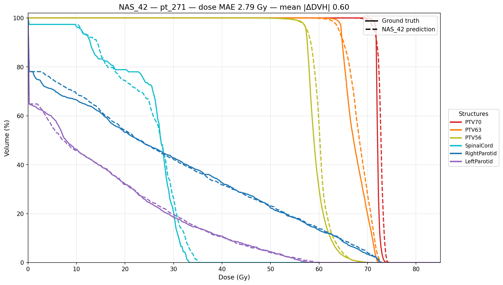
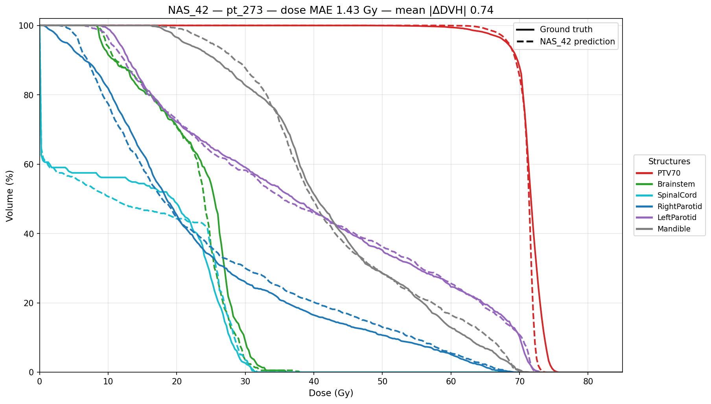
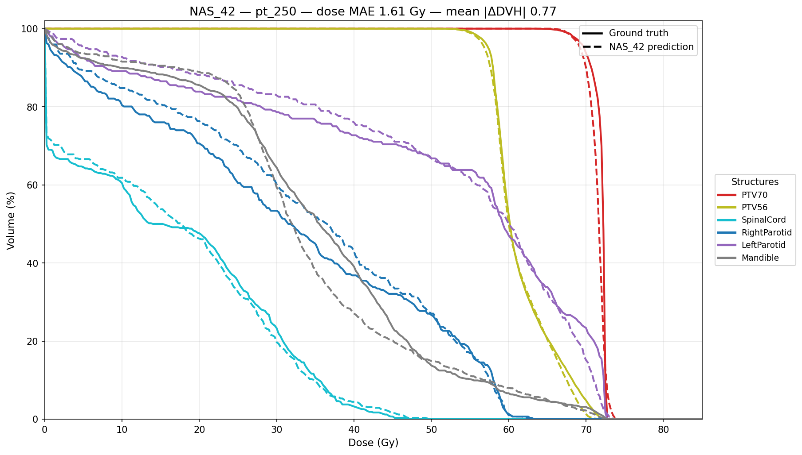
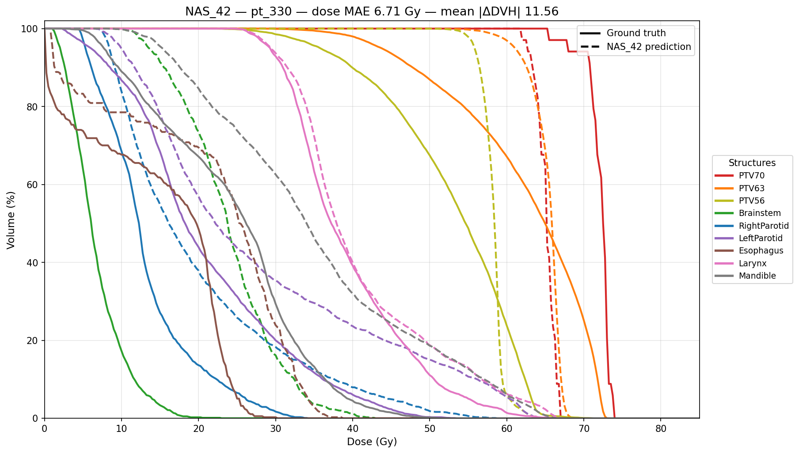
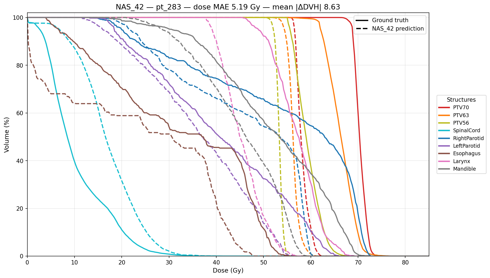
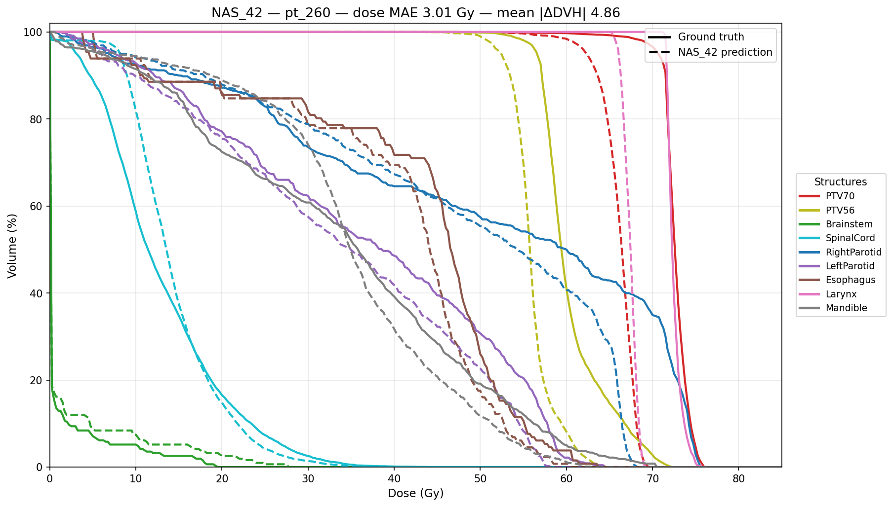

# NAS_42 — test-set results and DVH curves

Model: `NAS_42` (searched U-NAS architecture, 10,947,337 parameters)  
Checkpoint: `best_val_evaluation_index.pkl`  
Test split: OpenKBP patients **241–340** (100 patients)  
Inference: `python test.py --GPU_id 0 --TTA True`, TTA enabled (4 flips averaged)  
Metric definitions: same as `evaluate.py` (D1/D95/D99 for targets, D_0.1cc/mean for OARs; DVH score = mean absolute difference over all structure-metric entries).

## Training configuration

| Item | Value |
|---|---|
| Batch size | 2 |
| Iterations | 80,000 |
| Iterations / epoch | 500 (batch_size × 500 samples) |
| Epochs | 160 |
| Optimizer | Adam |
| Learning rate | 3e-4, cosine decay to 1e-7 |
| Weight decay | 3e-5 effective |
| Loss | masked L1 on dose / 70 |
| Validation | dose MAE on patients 201–240 |

## Test-set scores

| Metric | Value |
|---|---:|
| **Dose score (mean MAE)** | **2.564616 ± 1.063534 Gy** |
| **DVH score (mean absolute difference)** | **1.721568 ± 2.109162** |
| Patients | 100 |
| DVH metric entries | 1783 |

## Per-structure test scores

| Structure | Metric | n | GT mean | Pred mean | Mean abs diff |
|---|---|---:|---:|---:|---:|
| PTV70 | D1 | 100 | 74.0109 | 73.2099 | 1.6779 |
| PTV70 | D95 | 100 | 69.0845 | 68.2180 | 1.6298 |
| PTV70 | D99 | 100 | 66.7568 | 65.9895 | 2.0684 |
| PTV63 | D1 | 42 | 72.3295 | 71.1701 | 1.8578 |
| PTV63 | D95 | 42 | 62.9629 | 63.0703 | 1.9203 |
| PTV63 | D99 | 42 | 60.9571 | 60.7932 | 2.3732 |
| PTV56 | D1 | 91 | 68.9951 | 67.8612 | 1.7544 |
| PTV56 | D95 | 91 | 55.8841 | 56.4426 | 1.1456 |
| PTV56 | D99 | 91 | 53.2567 | 54.2823 | 1.6550 |
| Brainstem | D_0.1_cc | 89 | 31.9600 | 31.9607 | 2.4498 |
| Brainstem | mean | 89 | 8.4925 | 8.5414 | 1.0061 |
| SpinalCord | D_0.1_cc | 88 | 34.9463 | 35.7867 | 2.0540 |
| SpinalCord | mean | 88 | 16.9175 | 16.7721 | 0.9515 |
| RightParotid | D_0.1_cc | 99 | 62.9759 | 63.1109 | 1.9057 |
| RightParotid | mean | 99 | 32.0094 | 32.0437 | 1.3521 |
| LeftParotid | D_0.1_cc | 98 | 63.8743 | 63.8648 | 1.8560 |
| LeftParotid | mean | 98 | 31.5491 | 31.5297 | 1.3606 |
| Esophagus | D_0.1_cc | 43 | 54.6892 | 55.7317 | 2.7612 |
| Esophagus | mean | 43 | 27.7506 | 27.5033 | 1.8296 |
| Larynx | D_0.1_cc | 53 | 66.5834 | 65.9920 | 1.9057 |
| Larynx | mean | 53 | 47.9366 | 47.5148 | 1.9167 |
| Mandible | D_0.1_cc | 72 | 69.1744 | 68.8518 | 1.8031 |
| Mandible | mean | 72 | 40.1066 | 39.8737 | 1.6591 |

Ranking for the patient-level DVH curves below: **mean absolute DVH metric difference** across all delineated structures (lower is better).

## Best 3 patients by DVH agreement

| Rank | Patient | Dose MAE (Gy) | Mean abs DVH diff | Structures | Largest metric error |
|---:|---|---:|---:|---:|---|
| 1 | pt_271 | 2.7950 | 0.6015 | 6 | SpinalCord D_0.1_cc (1.906 Gy) |
| 2 | pt_273 | 1.4338 | 0.7417 | 6 | PTV70 D99 (2.881 Gy) |
| 3 | pt_250 | 1.6091 | 0.7725 | 6 | RightParotid mean (2.412 Gy) |

### Best 1: pt_271

Dose MAE **2.7950 Gy**, mean absolute DVH difference **0.6015**.

| Structure | Metric | GT | Prediction | Abs diff |
|---|---|---:|---:|---:|
| SpinalCord | D_0.1_cc | 32.562 | 34.468 | 1.906 |
| LeftParotid | D_0.1_cc | 57.214 | 58.808 | 1.594 |
| PTV63 | D99 | 63.807 | 62.491 | 1.316 |

Solid = ground truth, dashed = NAS_42 prediction. Full figure: `DVH/pt_271_dvh.png`.

### Best 2: pt_273

Dose MAE **1.4338 Gy**, mean absolute DVH difference **0.7417**.

| Structure | Metric | GT | Prediction | Abs diff |
|---|---|---:|---:|---:|
| PTV70 | D99 | 62.246 | 65.128 | 2.881 |
| PTV70 | D1 | 74.794 | 72.977 | 1.818 |
| Brainstem | D_0.1_cc | 32.925 | 31.930 | 0.995 |

Solid = ground truth, dashed = NAS_42 prediction. Full figure: `DVH/pt_273_dvh.png`.

### Best 3: pt_250

Dose MAE **1.6091 Gy**, mean absolute DVH difference **0.7725**.

| Structure | Metric | GT | Prediction | Abs diff |
|---|---|---:|---:|---:|
| RightParotid | mean | 31.802 | 34.214 | 2.412 |
| SpinalCord | D_0.1_cc | 45.083 | 46.791 | 1.708 |
| PTV56 | D1 | 71.497 | 70.108 | 1.389 |

Solid = ground truth, dashed = NAS_42 prediction. Full figure: `DVH/pt_250_dvh.png`.

## Worst 3 patients by DVH agreement

| Rank | Patient | Dose MAE (Gy) | Mean abs DVH diff | Structures | Largest metric error |
|---:|---|---:|---:|---:|---|
| 1 | pt_330 | 6.7072 | 11.5614 | 9 | PTV56 D99 (25.318 Gy) |
| 2 | pt_283 | 5.1856 | 8.6328 | 9 | PTV63 D1 (12.499 Gy) |
| 3 | pt_260 | 3.0097 | 4.8561 | 9 | PTV70 D95 (8.350 Gy) |

### Worst 1: pt_330

Dose MAE **6.7072 Gy**, mean absolute DVH difference **11.5614**.

| Structure | Metric | GT | Prediction | Abs diff |
|---|---|---:|---:|---:|
| PTV56 | D99 | 28.965 | 54.283 | 25.318 |
| RightParotid | D_0.1_cc | 32.479 | 55.844 | 23.365 |
| Brainstem | D_0.1_cc | 17.885 | 40.547 | 22.661 |

Solid = ground truth, dashed = NAS_42 prediction. Full figure: `DVH/pt_330_dvh.png`.

### Worst 2: pt_283

Dose MAE **5.1856 Gy**, mean absolute DVH difference **8.6328**.

| Structure | Metric | GT | Prediction | Abs diff |
|---|---|---:|---:|---:|
| PTV63 | D1 | 72.413 | 59.914 | 12.499 |
| Mandible | D_0.1_cc | 71.288 | 58.867 | 12.421 |
| PTV70 | D95 | 68.840 | 56.569 | 12.271 |

Solid = ground truth, dashed = NAS_42 prediction. Full figure: `DVH/pt_283_dvh.png`.

### Worst 3: pt_260

Dose MAE **3.0097 Gy**, mean absolute DVH difference **4.8561**.

| Structure | Metric | GT | Prediction | Abs diff |
|---|---|---:|---:|---:|
| PTV70 | D95 | 70.682 | 62.332 | 8.350 |
| Mandible | D_0.1_cc | 70.339 | 62.127 | 8.212 |
| PTV56 | D1 | 71.121 | 63.076 | 8.045 |

Solid = ground truth, dashed = NAS_42 prediction. Full figure: `DVH/pt_260_dvh.png`.

<!-- CI_HI_START -->
## Conformity and homogeneity indices (PTV)

Computed on the test patients 241–340, using the ground-truth PTV masks and the predicted / reference dose volumes.

**Definitions**

- **Conformity Index (Paddick):** `CI = TV_PIV² / (TV × PIV)`, where `PIV` is the prescription-isodose volume and `TV_PIV` is the PTV volume receiving at least the prescription dose. Range 0–1, **higher is better**, 1 = ideal.
- **Homogeneity Index (ICRU-83):** `HI = (D2 − D98) / D50` inside the PTV. **Lower is better**, 0 = ideal.
- Prescriptions: PTV70 = 70 Gy, PTV63 = 63 Gy, PTV56 = 56 Gy.
- If no voxel reaches the prescription dose (`PIV = 0`), CI is reported as **0** (failed coverage) rather than undefined.
- PTV63/PTV56 are nested with the higher-dose targets, so their Paddick CI is intrinsically lower: the prescription isodose volume includes the boost region. **PTV70 is the most directly interpretable target-conformity value.**

| PTV | n | CI pred | CI GT | HI pred | HI GT |
|---|---:|---:|---:|---:|---:|
| PTV70 | 100 | 0.7544 ± 0.1949 | 0.7633 ± 0.2000 | 0.0853 ± 0.0253 | 0.0831 ± 0.0439 |
| PTV63 | 42 | 0.2350 ± 0.2229 | 0.2338 ± 0.2027 | 0.1357 ± 0.0242 | 0.1507 ± 0.0659 |
| PTV56 | 91 | 0.3178 ± 0.1940 | 0.3007 ± 0.1912 | 0.1957 ± 0.0437 | 0.2281 ± 0.0631 |
| **Overall** | **233** | **0.4903 ± 0.3054** | **0.4872 ± 0.3110** | **0.1375 ± 0.0602** | **0.1519 ± 0.0864** |

The per-PTV raw values (including coverage, RTOG CI, D2/D98/D50) are in `Evaluation/ci_hi_metrics.csv`.
<!-- CI_HI_END -->

<!-- PER_PATIENT_START -->
## Per-patient test scores (100 patients)

Dose = MAE within `possible_dose_mask` (Gy); DVH = mean absolute difference over all structure-metric entries; CI = Paddick; HI = ICRU-83. PTV70 is present for all 100 patients; PTV63/PTV56 are shown where delineated (`—` otherwise).

| Patient | Dose MAE (Gy) | DVH MAE | CI PTV70 | HI PTV70 | CI PTV63 | HI PTV63 | CI PTV56 | HI PTV56 |
|---:|---:|---:|---:|---:|---:|---:|---:|---:|
| pt_241 | 2.2678 | 1.2150 | 0.8295 | 0.0409 | 0.6624 | 0.1267 | 0.2981 | 0.1070 |
| pt_242 | 1.6931 | 1.7543 | 0.8632 | 0.0630 | — | — | 0.7212 | 0.2197 |
| pt_243 | 3.7417 | 1.4208 | 0.8219 | 0.0851 | 0.0036 | 0.0797 | 0.4652 | 0.2268 |
| pt_244 | 1.8985 | 1.0321 | 0.8941 | 0.0706 | — | — | 0.4030 | 0.2059 |
| pt_245 | 2.8841 | 2.3179 | 0.5500 | 0.0843 | 0.0529 | 0.1166 | 0.1500 | 0.1999 |
| pt_246 | 2.5373 | 1.0529 | 0.9176 | 0.0684 | 0.0583 | 0.1127 | 0.1782 | 0.2080 |
| pt_247 | 1.7700 | 1.0168 | 0.8542 | 0.0911 | — | — | 0.2594 | 0.2138 |
| pt_248 | 2.0015 | 1.8092 | 0.7965 | 0.1098 | — | — | 0.8776 | 0.1498 |
| pt_249 | 3.5267 | 1.6621 | 0.6657 | 0.1268 | — | — | 0.0932 | 0.2155 |
| pt_250 | 1.6091 | 0.7725 | 0.8703 | 0.0709 | — | — | 0.5948 | 0.2319 |
| pt_251 | 3.0143 | 0.8192 | 0.9037 | 0.0452 | 0.3302 | 0.1326 | 0.3083 | 0.1563 |
| pt_252 | 3.0295 | 1.0270 | 0.7072 | 0.1282 | — | — | 0.2472 | 0.1385 |
| pt_253 | 2.8606 | 1.8454 | 0.7053 | 0.0793 | 0.3379 | 0.1437 | 0.3266 | 0.2139 |
| pt_254 | 3.0559 | 1.3501 | 0.7703 | 0.0940 | — | — | 0.2670 | 0.2462 |
| pt_255 | 2.8398 | 1.5918 | 0.7649 | 0.1178 | — | — | 0.3743 | 0.1077 |
| pt_256 | 1.4579 | 1.1659 | 0.8869 | 0.0766 | — | — | 0.5376 | 0.2318 |
| pt_257 | 2.3938 | 0.9409 | 0.9397 | 0.0488 | 0.0282 | 0.0615 | 0.6036 | 0.1898 |
| pt_258 | 1.7441 | 1.6027 | 0.8622 | 0.0782 | — | — | 0.3617 | 0.2372 |
| pt_259 | 2.1585 | 1.4948 | 0.8192 | 0.0487 | 0.6356 | 0.1769 | 0.1826 | 0.0968 |
| pt_260 | 3.0097 | 4.8561 | 0.0000 | 0.1246 | — | — | 0.0580 | 0.2071 |
| pt_261 | 3.0665 | 1.1750 | 0.7673 | 0.0651 | 0.4246 | 0.1541 | 0.0901 | 0.2281 |
| pt_262 | 2.8749 | 1.2908 | 0.7527 | 0.1014 | — | — | 0.2636 | 0.1765 |
| pt_263 | 1.9422 | 1.5295 | 0.8322 | 0.0858 | — | — | 0.5703 | 0.2048 |
| pt_264 | 2.3109 | 0.9457 | 0.8136 | 0.0454 | 0.3801 | 0.1495 | 0.0784 | 0.2209 |
| pt_265 | 1.6968 | 1.4272 | 0.8062 | 0.1013 | — | — | 0.2658 | 0.1904 |
| pt_266 | 2.9266 | 1.0369 | 0.7759 | 0.1111 | — | — | 0.3091 | 0.1420 |
| pt_267 | 2.6071 | 1.5886 | 0.7824 | 0.0758 | — | — | 0.6046 | 0.2327 |
| pt_268 | 2.9709 | 1.8310 | 0.8114 | 0.1201 | 0.0102 | 0.1962 | 0.0601 | 0.2438 |
| pt_269 | 1.9406 | 2.2349 | 0.7514 | 0.0942 | — | — | 0.0023 | 0.0850 |
| pt_270 | 4.4124 | 1.8068 | 0.6107 | 0.0786 | — | — | 0.0751 | 0.2057 |
| pt_271 | 2.7950 | 0.6015 | 0.7900 | 0.0443 | 0.3506 | 0.1319 | 0.3109 | 0.1580 |
| pt_272 | 3.1436 | 2.5044 | 0.6297 | 0.1194 | — | — | 0.0797 | 0.2213 |
| pt_273 | 1.4338 | 0.7417 | 0.8418 | 0.0846 | — | — | — | — |
| pt_274 | 3.7546 | 1.6106 | 0.6679 | 0.1270 | — | — | 0.3229 | 0.1270 |
| pt_275 | 2.8748 | 1.5413 | 0.8981 | 0.0757 | 0.0175 | 0.1263 | 0.3906 | 0.2231 |
| pt_276 | 1.4986 | 1.7708 | 0.8787 | 0.0790 | 0.1516 | 0.1442 | 0.1704 | 0.2104 |
| pt_277 | 1.5617 | 0.7738 | 0.8308 | 0.1027 | — | — | 0.2447 | 0.1748 |
| pt_278 | 3.5347 | 0.9733 | 0.8509 | 0.0956 | 0.1430 | 0.1469 | 0.1721 | 0.2296 |
| pt_279 | 2.1796 | 0.8315 | 0.1872 | 0.0518 | 0.1924 | 0.1288 | 0.4391 | 0.1582 |
| pt_280 | 2.3785 | 1.4939 | 0.6147 | 0.0860 | — | — | 0.6645 | 0.2150 |
| pt_281 | 2.1772 | 1.3514 | 0.7615 | 0.1163 | — | — | 0.3826 | 0.2129 |
| pt_282 | 1.8332 | 1.8782 | 0.7257 | 0.1034 | — | — | — | — |
| pt_283 | 5.1856 | 8.6328 | 0.0000 | 0.0851 | 0.0000 | 0.0981 | 0.0000 | 0.0575 |
| pt_284 | 2.4814 | 2.5764 | 0.7651 | 0.1077 | — | — | 0.1306 | 0.1626 |
| pt_285 | 2.1490 | 1.6298 | 0.7053 | 0.0639 | — | — | 0.7612 | 0.2066 |
| pt_286 | 2.1097 | 2.0285 | 0.7820 | 0.1350 | — | — | 0.1855 | 0.1072 |
| pt_287 | 3.1739 | 1.1643 | 0.9202 | 0.0818 | 0.0031 | 0.1386 | 0.1633 | 0.2343 |
| pt_288 | 1.3606 | 1.0167 | 0.5753 | 0.0550 | 0.6265 | 0.1481 | 0.3469 | 0.1427 |
| pt_289 | 2.7569 | 1.3624 | 0.7381 | 0.0547 | 0.3359 | 0.1460 | 0.2025 | 0.2114 |
| pt_290 | 3.3015 | 2.2235 | 0.6799 | 0.1032 | 0.0055 | 0.1584 | 0.1154 | 0.2491 |
| pt_291 | 1.3727 | 1.2905 | 0.8088 | 0.1032 | — | — | 0.5442 | 0.2111 |
| pt_292 | 2.3429 | 1.4452 | 0.7403 | 0.0782 | — | — | 0.4006 | 0.2171 |
| pt_293 | 1.6751 | 2.4354 | 0.8047 | 0.0992 | — | — | — | — |
| pt_294 | 1.9511 | 1.3062 | 0.7851 | 0.1000 | — | — | 0.4622 | 0.2213 |
| pt_295 | 2.6434 | 1.3270 | 0.9063 | 0.0792 | — | — | 0.3190 | 0.2293 |
| pt_296 | 1.2504 | 1.0779 | 0.8925 | 0.0860 | — | — | 0.3120 | 0.2180 |
| pt_297 | 3.5814 | 2.2456 | 0.8465 | 0.0852 | 0.0350 | 0.1332 | 0.5206 | 0.2257 |
| pt_298 | 2.3027 | 1.1013 | 0.8934 | 0.0766 | — | — | 0.3095 | 0.2576 |
| pt_299 | 1.7085 | 1.5094 | 0.8812 | 0.0913 | — | — | 0.4246 | 0.2068 |
| pt_300 | 3.8536 | 1.3636 | 0.6557 | 0.0446 | 0.4870 | 0.1425 | 0.2638 | 0.2000 |
| pt_301 | 3.0605 | 0.9700 | 0.8218 | 0.0688 | 0.3102 | 0.1454 | 0.1867 | 0.1330 |
| pt_302 | 3.5753 | 1.6464 | 0.8468 | 0.1128 | 0.0260 | 0.1208 | 0.2701 | 0.2290 |
| pt_303 | 2.6154 | 1.3070 | 0.8833 | 0.0512 | 0.1552 | 0.1051 | 0.5895 | 0.2126 |
| pt_304 | 1.8161 | 1.7681 | 0.8098 | 0.1139 | — | — | 0.2258 | 0.1790 |
| pt_305 | 2.9307 | 1.4548 | 0.8468 | 0.0831 | 0.0235 | 0.1215 | 0.2038 | 0.2403 |
| pt_306 | 1.4083 | 1.2595 | 0.8031 | 0.1189 | — | — | 0.3038 | 0.1750 |
| pt_307 | 1.8336 | 1.6949 | 0.8163 | 0.1012 | — | — | 0.2639 | 0.1709 |
| pt_308 | 2.6026 | 1.1870 | 0.8992 | 0.0554 | 0.3475 | 0.1557 | 0.1871 | 0.1822 |
| pt_309 | 1.7896 | 2.2503 | 0.8782 | 0.0601 | 0.0468 | 0.1164 | 0.0971 | 0.1396 |
| pt_310 | 3.6662 | 1.3461 | 0.8745 | 0.0673 | 0.2206 | 0.1325 | 0.1014 | 0.2290 |
| pt_311 | 1.6264 | 1.4559 | 0.8708 | 0.0649 | — | — | 0.6602 | 0.2319 |
| pt_312 | 1.4927 | 1.1893 | 0.8282 | 0.1053 | — | — | 0.1916 | 0.1428 |
| pt_313 | 1.7107 | 1.1881 | 0.5007 | 0.0564 | 0.2661 | 0.1156 | 0.3628 | 0.2030 |
| pt_314 | 2.3820 | 1.9338 | 0.8243 | 0.0788 | — | — | 0.5912 | 0.2365 |
| pt_315 | 2.0729 | 1.6430 | 0.8406 | 0.0678 | — | — | 0.6021 | 0.2440 |
| pt_316 | 2.8314 | 1.5916 | 0.8125 | 0.1192 | — | — | 0.1018 | 0.2941 |
| pt_317 | 3.7571 | 2.0630 | 0.9175 | 0.0826 | 0.0161 | 0.1301 | 0.2682 | 0.2424 |
| pt_318 | 5.3439 | 1.6277 | 0.7515 | 0.0564 | 0.4668 | 0.1742 | 0.2192 | 0.1846 |
| pt_319 | 1.7289 | 1.9101 | 0.6843 | 0.1211 | — | — | — | — |
| pt_320 | 1.7275 | 1.0424 | 0.6355 | 0.1163 | — | — | 0.4097 | 0.2321 |
| pt_321 | 3.3415 | 2.8852 | 0.8158 | 0.0998 | 0.3591 | 0.1610 | 0.1672 | 0.2501 |
| pt_322 | 2.0476 | 1.7171 | 0.8794 | 0.0934 | — | — | — | — |
| pt_323 | 7.2708 | 3.3722 | 0.0071 | 0.1024 | — | — | 0.0621 | 0.1388 |
| pt_324 | 1.9306 | 0.9158 | 0.8566 | 0.0366 | 0.5057 | 0.1455 | 0.2884 | 0.1571 |
| pt_325 | 3.3079 | 0.8987 | 0.6176 | 0.1292 | — | — | 0.2360 | 0.1392 |
| pt_326 | 1.8443 | 1.3275 | 0.7392 | 0.0590 | — | — | 0.6853 | 0.2088 |
| pt_327 | 1.9812 | 1.2480 | 0.7785 | 0.0390 | 0.3626 | 0.1474 | 0.3453 | 0.1730 |
| pt_328 | 1.8143 | 1.0688 | 0.6084 | 0.1070 | — | — | 0.8005 | 0.1910 |
| pt_329 | 4.4652 | 4.3448 | 0.7819 | 0.1488 | — | — | — | — |
| pt_330 | 6.7072 | 11.5614 | 0.0000 | 0.0706 | 0.8653 | 0.1309 | 0.1700 | 0.1215 |
| pt_331 | 2.7461 | 1.2254 | 0.8031 | 0.0422 | 0.4512 | 0.1465 | 0.1574 | 0.2048 |
| pt_332 | 1.6958 | 1.9871 | 0.2824 | 0.1150 | — | — | — | — |
| pt_333 | 1.5417 | 0.8606 | 0.8808 | 0.0907 | — | — | 0.4396 | 0.2104 |
| pt_334 | 1.2585 | 0.9528 | 0.8877 | 0.0588 | — | — | 0.5558 | 0.2386 |
| pt_335 | 3.9695 | 0.9821 | 0.9219 | 0.0649 | 0.0304 | 0.1184 | 0.2890 | 0.2068 |
| pt_336 | 2.7493 | 1.4862 | 0.9032 | 0.0836 | 0.0263 | 0.1382 | 0.2071 | 0.2300 |
| pt_337 | 1.4884 | 0.9809 | 0.8485 | 0.0714 | — | — | — | — |
| pt_338 | 1.4425 | 1.4034 | 0.7622 | 0.0983 | — | — | — | — |
| pt_339 | 1.7372 | 2.7857 | 0.8286 | 0.0870 | 0.0904 | 0.1671 | 0.1698 | 0.1922 |
| pt_340 | 2.5416 | 1.1034 | 0.9069 | 0.0817 | 0.0271 | 0.1324 | 0.2460 | 0.2243 |
| **Mean** | 2.5646 | 1.7106 | 0.7544 | 0.0853 | 0.2350 | 0.1357 | 0.3178 | 0.1957 |

Mean CI/HI for PTV63/PTV56 are over the patients where the structure is delineated. Because PTV63/PTV56 are nested with higher-dose targets, their Paddick CI is intrinsically lower; PTV70 is the primary conformity value.
The Mean row is the unweighted average over the 100 patients; the official DVH score in the test-set table above averages over all 1,783 structure-metric entries, so it can differ slightly from the mean of the per-patient DVH column.
<!-- PER_PATIENT_END -->

## All outputs

- `Evaluation/EVALUATION.md` — full evaluation report
- `Evaluation/per_patient_metrics.csv` — 100 rows
- `Evaluation/per_structure_metrics.csv` — 1783 metric rows
- `Evaluation/ci_hi_metrics.csv` — PTV conformity/homogeneity raw values
- `DVH/pt_241_dvh.png` … `DVH/pt_340_dvh.png` — one DVH figure per test patient
- `DVH/all_patients_dvh.pdf` — multi-page PDF with the mean summary
- `DVH/mean_dvh_per_structure.png` — mean GT/prediction DVH per structure
- `DVH/dvh_curves.npz` — raw curves on a 0.25 Gy grid
