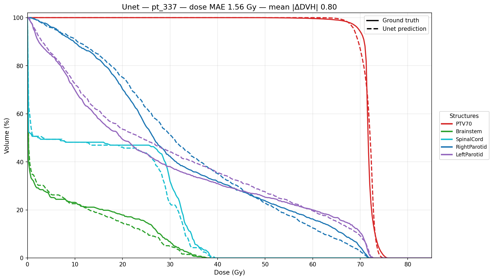
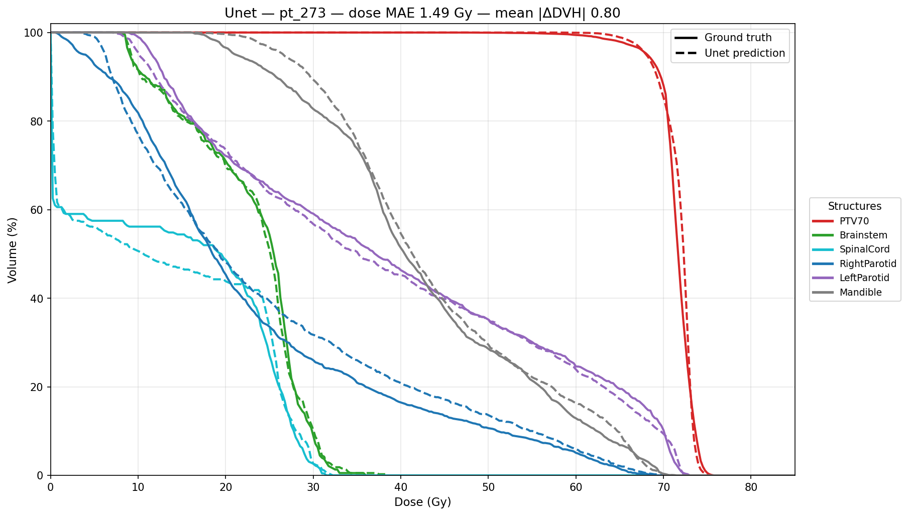
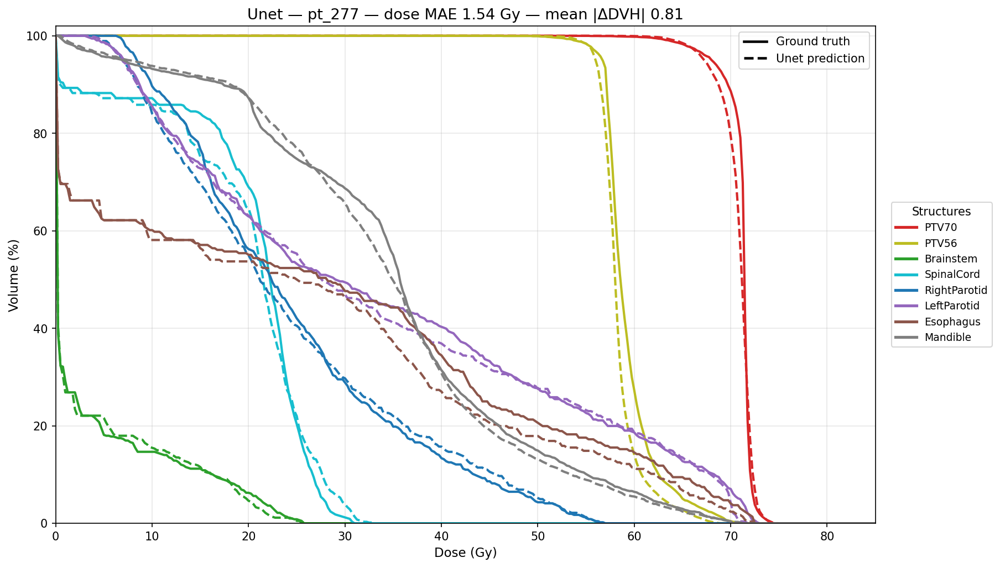
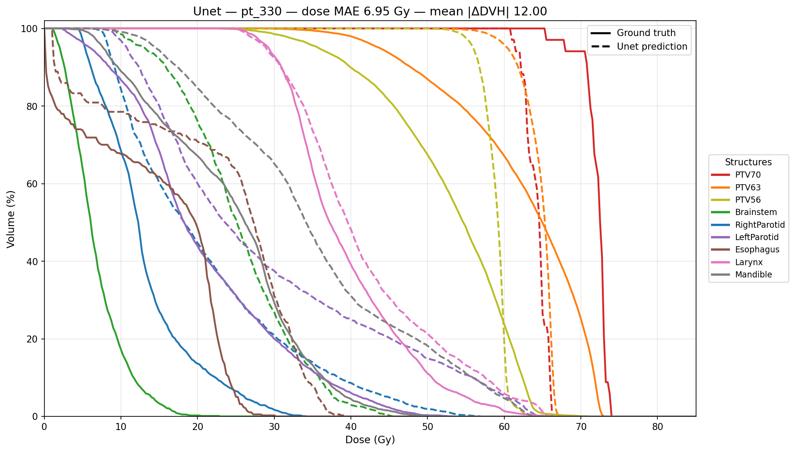
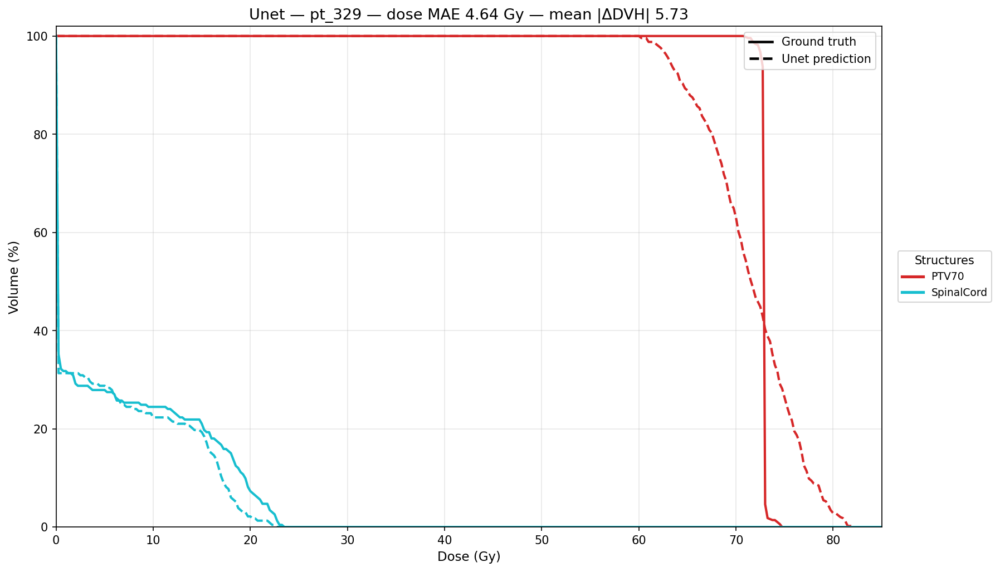
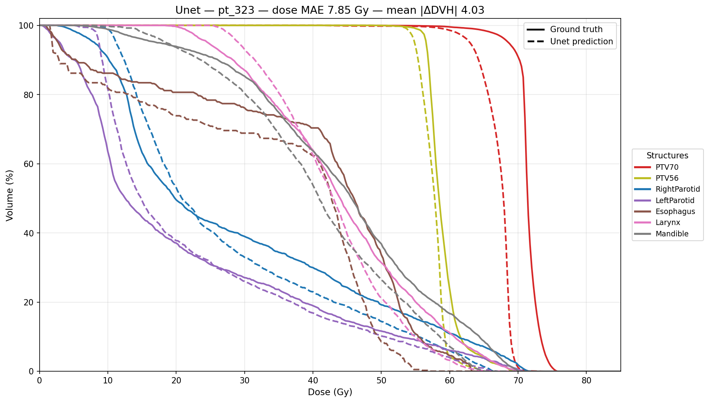

# Unet — test-set results and DVH curves

Model: `Unet` (6,471,713 parameters)  
Checkpoint: `best_val_evaluation_index.pkl`  
Test split: OpenKBP patients **241–340** (100 patients)  
Inference: `python test.py --GPU_id 0 --TTA True`, TTA enabled (4 flips averaged)  
Metric definitions: same as `NAS_29/evaluate.py` (D1/D95/D99 for targets, D_0.1cc/mean for OARs; DVH score = mean absolute difference over all structure-metric entries).

## Training configuration

| Item | Value |
|---|---|
| Batch size | 2 |
| Iterations | 80,000 |
| Iterations / epoch | 500 (batch_size × 500 samples) |
| Epochs | 160 |
| Optimizer | Adam |
| Learning rate | 3e-4, cosine decay to 1e-7 |
| Weight decay | 3e-5 effective |
| Loss | masked L1 on dose / 70 |
| Validation | dose MAE on patients 201–240 |

## Test-set scores

| Metric | Value |
|---|---:|
| **Dose score (mean MAE)** | **2.653749 ± 1.095257 Gy** |
| **DVH score (mean absolute difference)** | **1.808596 ± 2.066107** |
| Patients | 100 |
| DVH metric entries | 1783 |

## Per-structure test scores

| Structure | Metric | n | GT mean | Pred mean | Mean abs diff |
|---|---|---:|---:|---:|---:|
| PTV70 | D1 | 100 | 74.0109 | 73.4344 | 1.8683 |
| PTV70 | D95 | 100 | 69.0845 | 67.7892 | 1.8761 |
| PTV70 | D99 | 100 | 66.7568 | 65.5253 | 2.1407 |
| PTV63 | D1 | 42 | 72.3295 | 71.4787 | 1.9957 |
| PTV63 | D95 | 42 | 62.9629 | 63.0991 | 1.8967 |
| PTV63 | D99 | 42 | 60.9571 | 60.5558 | 2.4721 |
| PTV56 | D1 | 91 | 68.9951 | 67.8738 | 1.7985 |
| PTV56 | D95 | 91 | 55.8841 | 56.3480 | 1.2346 |
| PTV56 | D99 | 91 | 53.2567 | 53.9990 | 1.5210 |
| Brainstem | D_0.1_cc | 89 | 31.9600 | 32.4293 | 2.7123 |
| Brainstem | mean | 89 | 8.4925 | 8.7311 | 1.1252 |
| SpinalCord | D_0.1_cc | 88 | 34.9463 | 35.8912 | 1.8869 |
| SpinalCord | mean | 88 | 16.9175 | 16.6257 | 0.9252 |
| RightParotid | D_0.1_cc | 99 | 62.9759 | 63.1276 | 2.0124 |
| RightParotid | mean | 99 | 32.0094 | 31.8198 | 1.5607 |
| LeftParotid | D_0.1_cc | 98 | 63.8743 | 63.8792 | 1.8819 |
| LeftParotid | mean | 98 | 31.5491 | 31.2722 | 1.6646 |
| Esophagus | D_0.1_cc | 43 | 54.6892 | 55.3792 | 2.4935 |
| Esophagus | mean | 43 | 27.7506 | 27.3249 | 1.7566 |
| Larynx | D_0.1_cc | 53 | 66.5834 | 66.5221 | 1.9674 |
| Larynx | mean | 53 | 47.9366 | 47.5855 | 2.0641 |
| Mandible | D_0.1_cc | 72 | 69.1744 | 68.6357 | 2.0389 |
| Mandible | mean | 72 | 40.1066 | 39.9029 | 1.6797 |

Ranking for the patient-level DVH curves below: **mean absolute DVH metric difference** across all delineated structures (lower is better).

## Best 3 patients by DVH agreement

| Rank | Patient | Dose MAE (Gy) | Mean abs DVH diff | Structures | Largest metric error |
|---:|---|---:|---:|---:|---|
| 1 | pt_337 | 1.5554 | 0.8002 | 5 | LeftParotid mean (1.874 Gy) |
| 2 | pt_273 | 1.4946 | 0.8048 | 6 | PTV70 D99 (2.608 Gy) |
| 3 | pt_277 | 1.5444 | 0.8118 | 8 | PTV56 D1 (2.449 Gy) |

### Best 1: pt_337

Dose MAE **1.5554 Gy**, mean absolute DVH difference **0.8002**.

| Structure | Metric | GT | Prediction | Abs diff |
|---|---|---:|---:|---:|
| LeftParotid | mean | 28.881 | 30.755 | 1.874 |
| PTV70 | D99 | 65.238 | 66.540 | 1.302 |
| RightParotid | mean | 32.839 | 33.940 | 1.101 |

Solid = ground truth, dashed = Unet prediction. Full figure: `DVH/pt_337_dvh.png`.

### Best 2: pt_273

Dose MAE **1.4946 Gy**, mean absolute DVH difference **0.8048**.

| Structure | Metric | GT | Prediction | Abs diff |
|---|---|---:|---:|---:|
| PTV70 | D99 | 62.246 | 64.854 | 2.608 |
| RightParotid | mean | 23.432 | 25.030 | 1.598 |
| Mandible | mean | 42.712 | 44.151 | 1.438 |

Solid = ground truth, dashed = Unet prediction. Full figure: `DVH/pt_273_dvh.png`.

### Best 3: pt_277

Dose MAE **1.5444 Gy**, mean absolute DVH difference **0.8118**.

| Structure | Metric | GT | Prediction | Abs diff |
|---|---|---:|---:|---:|
| PTV56 | D1 | 69.319 | 66.869 | 2.449 |
| Esophagus | mean | 26.969 | 25.108 | 1.861 |
| LeftParotid | D_0.1_cc | 72.712 | 70.973 | 1.739 |

Solid = ground truth, dashed = Unet prediction. Full figure: `DVH/pt_277_dvh.png`.

## Worst 3 patients by DVH agreement

| Rank | Patient | Dose MAE (Gy) | Mean abs DVH diff | Structures | Largest metric error |
|---:|---|---:|---:|---:|---|
| 1 | pt_330 | 6.9455 | 11.9975 | 9 | Brainstem D_0.1_cc (26.396 Gy) |
| 2 | pt_329 | 4.6428 | 5.7288 | 2 | PTV70 D99 (10.750 Gy) |
| 3 | pt_323 | 7.8474 | 4.0291 | 7 | Esophagus D_0.1_cc (8.709 Gy) |

### Worst 1: pt_330

Dose MAE **6.9455 Gy**, mean absolute DVH difference **11.9975**.

| Structure | Metric | GT | Prediction | Abs diff |
|---|---|---:|---:|---:|
| Brainstem | D_0.1_cc | 17.885 | 44.282 | 26.396 |
| PTV56 | D99 | 28.965 | 54.024 | 25.059 |
| RightParotid | D_0.1_cc | 32.479 | 54.778 | 22.299 |

Solid = ground truth, dashed = Unet prediction. Full figure: `DVH/pt_330_dvh.png`.

### Worst 2: pt_329

Dose MAE **4.6428 Gy**, mean absolute DVH difference **5.7288**.

| Structure | Metric | GT | Prediction | Abs diff |
|---|---|---:|---:|---:|
| PTV70 | D99 | 71.712 | 60.963 | 10.750 |
| PTV70 | D95 | 72.710 | 63.177 | 9.533 |
| PTV70 | D1 | 74.189 | 81.272 | 7.083 |

Solid = ground truth, dashed = Unet prediction. Full figure: `DVH/pt_329_dvh.png`.

### Worst 3: pt_323

Dose MAE **7.8474 Gy**, mean absolute DVH difference **4.0291**.

| Structure | Metric | GT | Prediction | Abs diff |
|---|---|---:|---:|---:|
| Esophagus | D_0.1_cc | 63.038 | 54.329 | 8.709 |
| PTV70 | D95 | 68.611 | 62.963 | 5.648 |
| Esophagus | mean | 39.593 | 34.191 | 5.402 |

Solid = ground truth, dashed = Unet prediction. Full figure: `DVH/pt_323_dvh.png`.

<!-- CI_HI_START -->
## Conformity and homogeneity indices (PTV)

Computed on the test patients 241–340, using the ground-truth PTV masks and the predicted / reference dose volumes.

**Definitions**

- **Conformity Index (Paddick):** `CI = TV_PIV² / (TV × PIV)`, where `PIV` is the prescription-isodose volume and `TV_PIV` is the PTV volume receiving at least the prescription dose. Range 0–1, **higher is better**, 1 = ideal.
- **Homogeneity Index (ICRU-83):** `HI = (D2 − D98) / D50` inside the PTV. **Lower is better**, 0 = ideal.
- Prescriptions: PTV70 = 70 Gy, PTV63 = 63 Gy, PTV56 = 56 Gy.
- If no voxel reaches the prescription dose (`PIV = 0`), CI is reported as **0** (failed coverage) rather than undefined.
- PTV63/PTV56 are nested with the higher-dose targets, so their Paddick CI is intrinsically lower: the prescription isodose volume includes the boost region. **PTV70 is the most directly interpretable target-conformity value.**

| PTV | n | CI pred | CI GT | HI pred | HI GT |
|---|---:|---:|---:|---:|---:|
| PTV70 | 100 | 0.6627 ± 0.2492 | 0.7633 ± 0.2000 | 0.0942 ± 0.0291 | 0.0831 ± 0.0439 |
| PTV63 | 42 | 0.2339 ± 0.2120 | 0.2338 ± 0.2027 | 0.1425 ± 0.0256 | 0.1507 ± 0.0659 |
| PTV56 | 91 | 0.3001 ± 0.1789 | 0.3007 ± 0.1912 | 0.1994 ± 0.0423 | 0.2281 ± 0.0631 |
| **Overall** | **233** | **0.4438 ± 0.2895** | **0.4872 ± 0.3110** | **0.1440 ± 0.0587** | **0.1519 ± 0.0864** |

The per-PTV raw values (including coverage, RTOG CI, D2/D98/D50) are in `Evaluation/ci_hi_metrics.csv`.
<!-- CI_HI_END -->

<!-- PER_PATIENT_START -->
## Per-patient test scores (100 patients)

Dose = MAE within `possible_dose_mask` (Gy); DVH = mean absolute difference over all structure-metric entries; CI = Paddick; HI = ICRU-83. PTV70 is present for all 100 patients; PTV63/PTV56 are shown where delineated (`—` otherwise).

| Patient | Dose MAE (Gy) | DVH MAE | CI PTV70 | HI PTV70 | CI PTV63 | HI PTV63 | CI PTV56 | HI PTV56 |
|---:|---:|---:|---:|---:|---:|---:|---:|---:|
| pt_241 | 2.2797 | 1.0902 | 0.5929 | 0.0406 | 0.6530 | 0.1195 | 0.2948 | 0.1187 |
| pt_242 | 2.1635 | 2.5101 | 0.7635 | 0.0688 | — | — | 0.6359 | 0.2172 |
| pt_243 | 3.4800 | 1.3443 | 0.7998 | 0.0895 | 0.0031 | 0.1011 | 0.4463 | 0.2236 |
| pt_244 | 2.0319 | 0.9896 | 0.9021 | 0.0820 | — | — | 0.3915 | 0.2081 |
| pt_245 | 3.1551 | 2.9384 | 0.0403 | 0.0869 | 0.0530 | 0.1050 | 0.1465 | 0.1985 |
| pt_246 | 2.7880 | 1.7305 | 0.8694 | 0.0852 | 0.0581 | 0.1274 | 0.1619 | 0.2349 |
| pt_247 | 1.9185 | 0.8724 | 0.7507 | 0.1115 | — | — | 0.2559 | 0.2125 |
| pt_248 | 2.4357 | 2.2003 | 0.7254 | 0.0778 | — | — | 0.8059 | 0.1644 |
| pt_249 | 3.4226 | 2.6188 | 0.8538 | 0.1092 | — | — | 0.1407 | 0.2026 |
| pt_250 | 1.8830 | 0.8922 | 0.8238 | 0.0798 | — | — | 0.5589 | 0.2420 |
| pt_251 | 3.3710 | 1.0721 | 0.7816 | 0.0498 | 0.3246 | 0.1225 | 0.3020 | 0.1657 |
| pt_252 | 3.2127 | 1.3245 | 0.3820 | 0.1300 | — | — | 0.2128 | 0.1431 |
| pt_253 | 3.2798 | 1.4338 | 0.6903 | 0.0643 | 0.2719 | 0.1596 | 0.3156 | 0.2502 |
| pt_254 | 3.2129 | 1.2285 | 0.8167 | 0.0960 | — | — | 0.2664 | 0.2625 |
| pt_255 | 3.1156 | 1.2829 | 0.1422 | 0.1173 | — | — | 0.2980 | 0.1121 |
| pt_256 | 1.5227 | 1.2322 | 0.8552 | 0.0884 | — | — | 0.5190 | 0.2548 |
| pt_257 | 2.1122 | 1.3640 | 0.9319 | 0.0592 | 0.0268 | 0.0705 | 0.5737 | 0.1933 |
| pt_258 | 1.8982 | 1.2249 | 0.7384 | 0.0814 | — | — | 0.3362 | 0.2424 |
| pt_259 | 2.1539 | 1.2429 | 0.5640 | 0.0503 | 0.5569 | 0.1854 | 0.1687 | 0.1106 |
| pt_260 | 2.3421 | 2.6853 | 0.5997 | 0.1148 | — | — | 0.1873 | 0.2436 |
| pt_261 | 3.2761 | 1.1746 | 0.6746 | 0.0737 | 0.4095 | 0.1596 | 0.0862 | 0.2007 |
| pt_262 | 2.9669 | 1.2860 | 0.4213 | 0.1083 | — | — | 0.2280 | 0.1919 |
| pt_263 | 2.2233 | 1.3719 | 0.8602 | 0.1062 | — | — | 0.5422 | 0.2225 |
| pt_264 | 2.4121 | 1.2062 | 0.7809 | 0.0751 | 0.3727 | 0.1528 | 0.0746 | 0.2432 |
| pt_265 | 1.7542 | 1.5522 | 0.7280 | 0.1127 | — | — | 0.2565 | 0.1840 |
| pt_266 | 2.8503 | 1.9316 | 0.2688 | 0.1138 | — | — | 0.2544 | 0.1738 |
| pt_267 | 2.5084 | 1.8531 | 0.6471 | 0.1093 | — | — | 0.5645 | 0.2246 |
| pt_268 | 2.8211 | 2.2166 | 0.7616 | 0.1073 | 0.0098 | 0.1692 | 0.0600 | 0.2358 |
| pt_269 | 1.8523 | 1.6907 | 0.4655 | 0.0990 | — | — | 0.0023 | 0.0851 |
| pt_270 | 4.8180 | 2.1204 | 0.3912 | 0.0876 | — | — | 0.0632 | 0.2122 |
| pt_271 | 2.7035 | 0.9351 | 0.8146 | 0.0604 | 0.3561 | 0.1273 | 0.3096 | 0.1520 |
| pt_272 | 3.1726 | 2.2878 | 0.6654 | 0.1352 | — | — | 0.0846 | 0.2299 |
| pt_273 | 1.4946 | 0.8048 | 0.8363 | 0.1080 | — | — | — | — |
| pt_274 | 3.2380 | 1.4995 | 0.2422 | 0.1198 | — | — | 0.2630 | 0.1136 |
| pt_275 | 3.2036 | 1.6459 | 0.8566 | 0.0740 | 0.0144 | 0.1574 | 0.3655 | 0.2165 |
| pt_276 | 1.5731 | 1.4806 | 0.8183 | 0.0925 | 0.1412 | 0.1311 | 0.1686 | 0.2100 |
| pt_277 | 1.5444 | 0.8118 | 0.7639 | 0.1064 | — | — | 0.2349 | 0.1800 |
| pt_278 | 3.4900 | 0.9844 | 0.8157 | 0.0981 | 0.1385 | 0.1506 | 0.1652 | 0.2508 |
| pt_279 | 2.7479 | 2.4726 | 0.0004 | 0.0806 | 0.1087 | 0.1369 | 0.3375 | 0.1489 |
| pt_280 | 2.8186 | 1.2230 | 0.8320 | 0.0961 | — | — | 0.6055 | 0.2141 |
| pt_281 | 2.2031 | 1.6201 | 0.2596 | 0.1235 | — | — | 0.3421 | 0.2108 |
| pt_282 | 1.7981 | 1.7646 | 0.6861 | 0.1149 | — | — | — | — |
| pt_283 | 3.8339 | 3.0353 | 0.0000 | 0.0425 | 0.3154 | 0.1241 | 0.0510 | 0.0972 |
| pt_284 | 2.6000 | 3.1247 | 0.8032 | 0.1257 | — | — | 0.1325 | 0.1716 |
| pt_285 | 2.1478 | 1.2446 | 0.7739 | 0.0612 | — | — | 0.7393 | 0.2023 |
| pt_286 | 2.1665 | 3.3408 | 0.3709 | 0.1521 | — | — | 0.1146 | 0.1256 |
| pt_287 | 3.3939 | 0.9555 | 0.8597 | 0.0917 | 0.0033 | 0.1300 | 0.1526 | 0.2306 |
| pt_288 | 1.4902 | 1.8312 | 0.0886 | 0.0931 | 0.6049 | 0.1202 | 0.3218 | 0.1171 |
| pt_289 | 3.1045 | 1.4381 | 0.7413 | 0.0606 | 0.3314 | 0.1535 | 0.2019 | 0.2000 |
| pt_290 | 3.4281 | 2.0653 | 0.6375 | 0.0965 | 0.0056 | 0.1840 | 0.1224 | 0.2313 |
| pt_291 | 1.5549 | 1.3521 | 0.7723 | 0.1052 | — | — | 0.5348 | 0.2100 |
| pt_292 | 2.7043 | 2.1118 | 0.2077 | 0.0860 | — | — | 0.3463 | 0.2204 |
| pt_293 | 1.6895 | 2.8500 | 0.7525 | 0.1165 | — | — | — | — |
| pt_294 | 2.0396 | 1.3658 | 0.6674 | 0.1062 | — | — | 0.4427 | 0.2216 |
| pt_295 | 3.0017 | 1.4347 | 0.8755 | 0.0975 | — | — | 0.3084 | 0.2327 |
| pt_296 | 1.3011 | 1.2487 | 0.7827 | 0.0972 | — | — | 0.3069 | 0.2192 |
| pt_297 | 3.3948 | 2.3150 | 0.7924 | 0.0878 | 0.0336 | 0.1601 | 0.5034 | 0.2169 |
| pt_298 | 2.7159 | 0.9370 | 0.8782 | 0.0897 | — | — | 0.3008 | 0.2601 |
| pt_299 | 1.8600 | 1.5721 | 0.8608 | 0.1042 | — | — | 0.4150 | 0.2142 |
| pt_300 | 4.2415 | 1.1625 | 0.6642 | 0.0608 | 0.4633 | 0.1504 | 0.2615 | 0.1906 |
| pt_301 | 3.2080 | 1.0706 | 0.8381 | 0.0650 | 0.2980 | 0.1402 | 0.1852 | 0.1582 |
| pt_302 | 3.6088 | 1.9612 | 0.8347 | 0.0997 | 0.0254 | 0.1120 | 0.2554 | 0.2428 |
| pt_303 | 2.7685 | 1.7536 | 0.8401 | 0.0676 | 0.1419 | 0.1382 | 0.5563 | 0.2191 |
| pt_304 | 1.7815 | 1.3683 | 0.8397 | 0.1172 | — | — | 0.2198 | 0.1825 |
| pt_305 | 2.9245 | 1.4143 | 0.8543 | 0.0946 | 0.0224 | 0.1311 | 0.1965 | 0.2478 |
| pt_306 | 1.4890 | 1.3641 | 0.7153 | 0.1466 | — | — | 0.2616 | 0.1969 |
| pt_307 | 1.9170 | 1.9713 | 0.8170 | 0.1052 | — | — | 0.2139 | 0.2062 |
| pt_308 | 2.6199 | 1.4977 | 0.8455 | 0.0651 | 0.3298 | 0.1497 | 0.1787 | 0.1869 |
| pt_309 | 1.9124 | 1.8019 | 0.7758 | 0.0668 | 0.0467 | 0.1332 | 0.0976 | 0.1496 |
| pt_310 | 4.0748 | 1.2079 | 0.8592 | 0.0810 | 0.2174 | 0.1359 | 0.0992 | 0.2207 |
| pt_311 | 1.7647 | 1.7051 | 0.8238 | 0.0752 | — | — | 0.6071 | 0.2253 |
| pt_312 | 1.5310 | 1.2149 | 0.6280 | 0.1104 | — | — | 0.1691 | 0.1581 |
| pt_313 | 1.7084 | 1.4082 | 0.7822 | 0.0644 | 0.4224 | 0.1101 | 0.3576 | 0.1884 |
| pt_314 | 2.2864 | 2.6515 | 0.5823 | 0.0997 | — | — | 0.5515 | 0.2307 |
| pt_315 | 2.1567 | 2.3705 | 0.7706 | 0.0755 | — | — | 0.5274 | 0.2283 |
| pt_316 | 2.9104 | 2.0548 | 0.6849 | 0.1103 | — | — | 0.0924 | 0.2942 |
| pt_317 | 4.0765 | 1.6078 | 0.8955 | 0.0988 | 0.0160 | 0.1968 | 0.2658 | 0.2316 |
| pt_318 | 5.7538 | 2.6998 | 0.6669 | 0.0654 | 0.4478 | 0.1919 | 0.1884 | 0.2021 |
| pt_319 | 1.6607 | 1.7306 | 0.2642 | 0.1187 | — | — | — | — |
| pt_320 | 1.5424 | 1.2666 | 0.6082 | 0.1295 | — | — | 0.4080 | 0.2215 |
| pt_321 | 3.0688 | 3.0644 | 0.7684 | 0.0905 | 0.3428 | 0.1661 | 0.1593 | 0.2435 |
| pt_322 | 2.1303 | 2.7123 | 0.8134 | 0.1026 | — | — | — | — |
| pt_323 | 7.8474 | 4.0291 | 0.0110 | 0.1301 | — | — | 0.0732 | 0.1344 |
| pt_324 | 2.0606 | 1.4929 | 0.7375 | 0.0453 | 0.4669 | 0.1491 | 0.2742 | 0.1789 |
| pt_325 | 3.2798 | 1.3757 | 0.0508 | 0.1280 | — | — | 0.1803 | 0.1271 |
| pt_326 | 2.0248 | 1.3458 | 0.8565 | 0.0559 | — | — | 0.6544 | 0.2132 |
| pt_327 | 2.0452 | 1.2996 | 0.7869 | 0.0651 | 0.3654 | 0.1591 | 0.3314 | 0.1999 |
| pt_328 | 1.6457 | 1.2570 | 0.5854 | 0.1414 | — | — | 0.7583 | 0.1648 |
| pt_329 | 4.6428 | 5.7288 | 0.4660 | 0.2584 | — | — | — | — |
| pt_330 | 6.9455 | 11.9975 | 0.0000 | 0.0768 | 0.8174 | 0.1258 | 0.1744 | 0.1194 |
| pt_331 | 2.8940 | 1.4391 | 0.7587 | 0.0525 | 0.4386 | 0.1396 | 0.1420 | 0.2376 |
| pt_332 | 1.6281 | 2.2096 | 0.1511 | 0.1141 | — | — | — | — |
| pt_333 | 1.5077 | 0.9062 | 0.8345 | 0.0982 | — | — | 0.4289 | 0.2100 |
| pt_334 | 1.4579 | 1.0820 | 0.8258 | 0.0749 | — | — | 0.5468 | 0.2354 |
| pt_335 | 4.3233 | 2.0099 | 0.8091 | 0.0719 | 0.0301 | 0.1231 | 0.2735 | 0.2089 |
| pt_336 | 2.8989 | 1.7137 | 0.8612 | 0.0990 | 0.0257 | 0.1804 | 0.2014 | 0.2341 |
| pt_337 | 1.5554 | 0.8002 | 0.8663 | 0.0885 | — | — | — | — |
| pt_338 | 1.4851 | 1.2547 | 0.7619 | 0.1089 | — | — | — | — |
| pt_339 | 1.7608 | 2.9967 | 0.7616 | 0.1043 | 0.0871 | 0.1424 | 0.1633 | 0.1706 |
| pt_340 | 2.5603 | 0.9938 | 0.8958 | 0.0953 | 0.0264 | 0.1609 | 0.2366 | 0.2176 |
| **Mean** | 2.6537 | 1.8243 | 0.6627 | 0.0942 | 0.2339 | 0.1425 | 0.3001 | 0.1994 |

Mean CI/HI for PTV63/PTV56 are over the patients where the structure is delineated. Because PTV63/PTV56 are nested with higher-dose targets, their Paddick CI is intrinsically lower; PTV70 is the primary conformity value.
The Mean row is the unweighted average over the 100 patients; the official DVH score in the test-set table above averages over all 1,783 structure-metric entries, so it can differ slightly from the mean of the per-patient DVH column.
<!-- PER_PATIENT_END -->

## All outputs

- `Evaluation/EVALUATION.md` — full evaluation report
- `Evaluation/per_patient_metrics.csv` — 100 rows
- `Evaluation/per_structure_metrics.csv` — every DVH metric row
- `Evaluation/ci_hi_metrics.csv` — PTV conformity/homogeneity raw values
- `DVH/pt_241_dvh.png` … `DVH/pt_340_dvh.png` — one DVH figure per test patient
- `DVH/all_patients_dvh.pdf` — multi-page PDF with the mean summary
- `DVH/mean_dvh_per_structure.png` — mean GT/prediction DVH per structure
- `DVH/dvh_curves.npz` — raw curves on a 0.25 Gy grid
